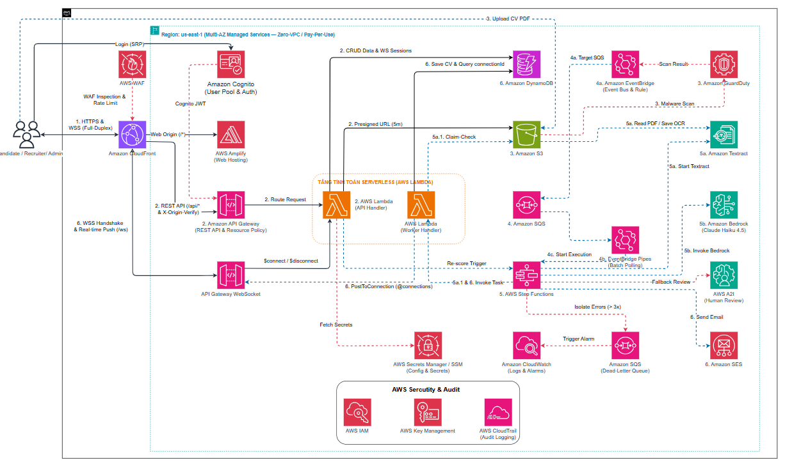

<h3 align="center">Project: Cloud Job — Cloud Recruitment Platform Powered by Automated AI Resume Screening</h3>

>**Cloud Job** is a dedicated recruitment web platform specializing in Cloud Computing careers (Cloud Computing, DevOps, Solutions Architect, SysOps), featuring an end-to-end automated AI screening pipeline powered by AWS Serverless & Generative AI.

---

### 1. Problem Overview

Driven by the rapid expansion of Cloud Computing, demand for high-caliber infrastructure talents—such as Cloud Engineers, DevOps specialists, SysOps administrators, and Solutions Architects—has grown exponentially. However, cloud roles demand strict technical criteria covering cloud service proficiencies (AWS, Containers, CI/CD, IaC) and formal certifications. When screening applications, enterprises face significant hurdles:
* Applications arrive in large volumes yet remain fragmented across email threads and generic submission forms.
* Technical leads and recruiters must manually open and scrutinize each PDF document to assess complex cloud skill sets, project histories, and certification validity.
* This process consumes dozens of hours every week, creating hiring bottlenecks, delayed candidate communications, and potential talent loss due to reviewer fatigue or cognitive bias.

**Proposed Approach:** Construct **Cloud Job** — an intelligent recruitment portal dedicated to the cloud employment market, architected on AWS Serverless and Generative AI:
* **Web Portal Interface:** Provides an intuitive experience for two key user personas: Technology Recruiters managing job listings and candidate pipelines; Cloud Candidates discovering specialized roles and submitting applications online.
* **Asynchronous Processing Pipeline:** When a candidate submits a PDF resume, it uploads directly to secure Amazon S3 storage via short-lived Presigned URLs, subsequently triggering an asynchronous processing chain via Amazon SQS to guarantee high availability without system bottlenecks.
* **AI Evaluation Pipeline:**
  * **Amazon Textract:** Automatically extracts raw text content from multi-page PDF resumes.
  * **Amazon Bedrock:** Leverages the Anthropic Claude Haiku 4.5 Large Language Model to evaluate resume contents against specific Job Description criteria. The model systematically compares cloud skills, project experiences, and AWS certifications, outputting quantitative scores, strength/gap assessments, and structured JSON summaries.
* **Automated Notifications:** Integrates Amazon SES to deliver automated confirmation emails to applicants and enable one-click interview invitations for recruiters.
* **Cost & Operational Optimization:** Operates entirely on a Serverless pay-as-you-go model with zero idle compute costs.

---

### 2. Objectives & Scope

#### Concrete Objectives
1. **Automate Preliminary Screening:** Reduce resume parsing and scoring latency from several minutes down to **under 60 seconds**, eliminating 80–90% of manual reading overhead.
2. **Enhance Objectivity and Consistency:** Enforce standardized evaluation criteria across all applications against job requirements, minimizing human bias.
3. **Modern Candidate & Recruiter Experience:** Provide intuitive dashboards, candidate score rankings with detailed evaluations, and real-time state updates delivered via WebSocket Push.
4. **Embody Cloud Architecture Best Practices:** Deliver the comprehensive **Cloud Job** platform combining over 10 AWS services strictly aligned with all 6 pillars of the AWS Well-Architected Framework: Security, Reliability, Performance Efficiency, Cost Optimization, Operational Excellence, and Sustainability.

#### Implementation Scope

* **MVP Scope (Core Deliverables):**
  * **Authentication & RBAC:** User management through Amazon Cognito with 3 distinct roles (`Candidate`, `Recruiter`, `Admin`) and Company Profile support for collaborative HR workflows.
  * **Job Management & Applications:** Recruiters publish, edit, and close job postings; Candidates search vacancies, manage profile information, and maintain default resumes.
  * **Standardized PDF Intake:** Exclusively supports PDF format up to 5MB uploaded directly to Amazon S3 via secure Presigned URLs; duplicate submission protection and application withdrawal mechanisms; dual lifecycle tracking for recruitment status and asynchronous AI processing status.
  * **Objective AI Pipeline:** Asynchronous processing orchestrated by Amazon SQS and AWS Lambda Workers; text extraction via Amazon Textract; automatic personal identification data filtering before invoking Amazon Bedrock Claude Haiku 4.5 for rubric-based scoring into structured JSON outputs.
  * **Human-in-the-Loop Review:** 3-column side-by-side comparison interface; internal recruiter notes, star ratings, status progression with an immutable audit trail; controlled re-scoring capabilities.
  * **Talent Pool & Analytics:** Candidate skill gap analytics; searchable talent repository with automated re-discovery recommendations for new job postings.
  * **Data Privacy & Operations:** Purpose-based consent tracking and DSR anonymization workflows; verified zero model training policy on Bedrock; automated email delivery via Amazon SES; centralized logs, metric dashboards, and alarms through Amazon CloudWatch; automated infrastructure clean-up routines.
* **Extended Scope (Post-MVP):**
  * Candidate job bookmarking.
  * Automated job notification subscriptions via email.
  * Multi-dimensional filtering for compensation ranges and remote/hybrid modes.
  * AWS WAF integration for edge protection on CloudFront and API Gateway.

---

### 3. Problems to Solve

#### Challenges and Limitations in Current Processes
* **Process Bottlenecks:** Typical hiring campaigns receive 100 to 300 resumes per opening. Manual reading, sorting, and documentation consume 15 to 25 hours per vacancy.
* **Slow Turnaround Times:** Candidates wait 1 to 3 weeks for preliminary feedback, risking dropouts to competing employers.
* **Lack of Standardization:** Unstructured evaluations and dispersed notes make objective comparisons across applicant cohorts difficult.
* **Prohibitive SaaS ATS Pricing:** Commercial recruitment tools demand costly monthly subscriptions ranging from $100 to $500, creating unnecessary expenses for smaller departments or short-term hiring drives.

#### Practical Efficiency and Cost Optimization Strategy
* **Time Savings:** Reduces initial resume screening time by over **80%**. Hiring managers focus immediate attention on pre-qualified candidate shortlists.
* **Ultra-Low Infrastructure Costs:** Leveraging serverless architectures results in operational costs of approximately **$1.00 – $2.00 USD / month** for testing and **~$28.08 USD / month** when processing 2,000 resumes.
* **Rapid Payback Period:** Achieves positive ROI within the initial operational month by saving dozens of skilled engineering and recruiter working hours.

---

### 4. Preliminary Solution Architecture

<em>Overall Cloud Job Pure Serverless Architecture on AWS (Multi-AZ Managed Services — Zero-VPC / Pay-Per-Use)</em>

The solution implements a 100% Pure Serverless layered architecture, fully decoupling low-latency synchronous API operations from background AI orchestration powered by EventBridge Pipes and Step Functions Claim-Check patterns:

#### Official AWS Service Catalog

| AWS Service | Category | Technical Role in System Architecture |
| :--- | :--- | :--- |
| **AWS WAF** | Edge Security | Protects perimeter traffic against SQL Injection, XSS, HTTP Floods, malicious bots, and request rate abuse via Global WebACLs associated with CloudFront. |
| **Amazon CloudFront** | Global Edge CDN | Unified Edge Ingress distributing Amplify React SPA assets, routing REST API traffic, and upgrading WebSocket handshakes using TLS 1.3. |
| **AWS Amplify Hosting** | Frontend Hosting | Hosts frontend assets with continuous integration and automated deployment pipelines connected directly to GitHub. |
| **Amazon Cognito** | Identity Management | Manages user registration, sign-in, and Role-Based Access Control (`Candidate`, `Recruiter`, `Admin`) along with custom enterprise attributes. |
| **Amazon API Gateway** | API Gateway | **REST API** secured with Resource Policies and Cognito JWT Authorizers; **WebSocket API** delivers live scoring results back to clients, eliminating HTTP polling. |
| **AWS Lambda** | Serverless Compute | Executes backend business logic: authorization verification, Presigned URL generation, idempotency validation, PII redaction, and JSON validation on Node.js TypeScript. |
| **Amazon S3** | Object Storage | Quarantines uploaded PDF resumes up to 5MB, partitions storage by verification state, and provides secure direct upload capabilities via 5-minute Presigned URLs. |
| **Amazon GuardDuty** | Threat Detection | Automatically scans uploaded resumes with Malware Protection for S3 before permitting downstream processing. |
| **Amazon SQS** | Message Queue | Buffers bursts and isolates traffic spikes, verifying idempotency keys (`document_id`) before initiating Step Functions workflows. |
| **Amazon SQS Dead-Letter Queue** | Error Isolation | Quarantines unrecoverable execution failures after 3 retry attempts to preserve data and support root cause investigation. |
| **Amazon EventBridge** | Event Routing | Filters GuardDuty malware scan outcomes and routes clean upload notifications to downstream consumers. |
| **Amazon EventBridge Pipes** | Event Integration | Connects Amazon SQS queues directly to AWS Step Functions with automated payload filtering and transformation. |
| **AWS Step Functions** | Workflow Orchestrator | Sequentially coordinates: Amazon Textract $\to$ PII Redaction $\to$ Amazon Bedrock Claude Haiku 4.5 scoring, complete with exponential backoff retries. |
| **Amazon Textract** | AI Document OCR | Reads PDF files directly from S3, providing asynchronous document parsing for multi-page resumes without keeping network connections open. |
| **Amazon Bedrock Runtime** | Generative AI | Executes Anthropic Claude Haiku 4.5 to transform unstructured resumes into validated JSON schemas based on a standardized 100-point rubric. |
| **Amazon A2I** | Human-in-the-Loop | Serves as an automated fallback when OCR confidence scores drop below 80% or output formatting fails, routing resumes into human review queues. |
| **Amazon DynamoDB** | NoSQL Database | Single-Table On-Demand database with sub-10ms response times, persisting structured resume JSON records, idempotency locks, and candidate rankings. |
| **Amazon SES** | Email Communication | Dispatches automated submission acknowledgments, screening completion summaries, and interview invitation emails. |
| **Amazon CloudWatch** | Observability | Aggregates structured logs, monitors operational metrics in real-time, and triggers alerts on DLQ backlogs or threshold breaches. |
| **AWS KMS** | Data Encryption | Manages Customer Managed Keys (CMK) to ensure cryptographic envelope encryption for data at rest in Amazon S3 and Amazon DynamoDB. |

#### 4 Key Technical Differentiators
1. **Automated Quarantine & Malware Screening:** Restricts client uploads to temporary server-generated Presigned URLs; all incoming files land inside an isolated S3 quarantine bucket and undergo automatic malware inspection via Amazon GuardDuty.
2. **Sequential Step Functions Orchestration with A2I Fallback:** Utilizes Claim-Check patterns to prevent payload overflows; coordinates Textract OCR and Bedrock Claude Haiku 4.5 evaluation, automatically redirecting anomalous outputs to human reviewers via Amazon A2I.
3. **Event Idempotency & Real-Time WebSocket Push:** Idempotency locks based on document identifiers prevent duplicate processing expenses during repeated S3 upload events; scoring results push immediately to client viewports over WebSockets.
4. **Pure Serverless Zero-Cost Network:** Completely eliminates fixed monthly expenses associated with VPCs, NAT Gateways, and PrivateLink endpoints; relies on IAM Zero-Trust and TLS 1.3 over the AWS Global Backbone with $0.00/month idle networking charges.

---

### 5. Implementation Plan & Timeline

The 9-week development roadmap spans from October 27, 2026 to December 31, 2026, advancing through 7 synchronized phases balancing infrastructure-as-code and frontend interfaces across defined milestones:

| Phase | Timeframe | AWS Service Configuration Focus | Frontend Development & Control Milestones |
| :---: | :---: | :--- | :--- |
| **Phase 0** Analysis & Design | Oct 27 – Oct 31 | Technical requirements specification, Serverless architecture sign-off, DynamoDB schema, API design, 100-point rubric, and AWS Pricing Calculator estimates. | **Milestone M0 (Oct 31):** Completion of SRS documentation, architecture diagrams, API/DB specifications, and project proposal. |
| **Phase 1** Foundations & Auth | Nov 01 – Nov 08 | AWS CDK/SAM initialization; Cognito user pool with 3 role groups, S3 Quarantine, SQS queues, CloudFront distribution, AWS WAF, and Amplify Hosting. | Delineate React Vite scaffolding; complete public Job Board and authentication login/register views. **Milestone M1 (Nov 08):** Cloud networking, authentication, and core application shell operational. |
| **Phase 2** Core Business & S3 Intake | Nov 09 – Nov 22 | API Gateway REST endpoints and Lambda business handlers for company profiles, job listings, and Presigned URLs; S3 Quarantine, GuardDuty integration, and SQS idempotency. | Candidate workflows: Direct PDF uploads to S3 Quarantine, dual-status application tracking, and application withdrawal; recruiter vacancy management. **Milestone M2 (Nov 22):** Job posting, quarantine uploads, and queueing pipelines operational. |
| **Phase 3** AI Step Functions & A2I | Nov 23 – Dec 06 | Step Functions orchestration: Textract OCR $\to$ PII sanitization $\to$ Bedrock Claude Haiku 4.5 rubric scoring; retry policies and Amazon A2I fallback routing. | Recruiter workflows: Candidate leaderboard, 3-column side-by-side review with manual review fallback modes, and talent rediscovery. **Milestone M3 (Dec 06):** Automated AI evaluation pipeline and recruiter review dashboard complete. |
| **Phase 4** WebSockets, SES & Admin | Dec 07 – Dec 13 | API Gateway WebSocket endpoints delivering sub-500ms push updates; Amazon SES email templates; DSR anonymization handlers, CloudWatch dashboards, and alarms. | Frontend WebSocket integration; complete administrative dashboard, dead-letter queue monitoring, and data privacy compliance views. **Milestone M4 (Dec 13):** Full integration of all AWS services and frontend interfaces complete. |
| **Phase 5** Testing & Feature Freeze | Dec 14 – Dec 20 | End-to-end integration testing: S3 Quarantine validation, idempotency controls, Step Functions retries, A2I fallbacks, WebSocket push, prompt injection defenses, and 50-resume load tests; cost audits. | End-to-end UI regression testing across all screens; formal feature freeze and production v1.0.0 release tagging. **Milestone M5 (Dec 20):** 100% test cases verified, solution demo-ready. |
| **Phase 6** Documentation & Final Handover | Dec 21 – Dec 31 | Author reproducible bilingual workshop lab guides; finalize automated one-click teardown scripts ensuring $0.00 residual cost upon stack deletion. | Produce comprehensive video demonstration covering Step Functions execution graphs and live WebSocket push notifications; final submission compilation. **Milestone M6 (Dec 31):** Project documentation and submission complete. |

---

### 6. Budget & Cost Estimation (Cost Estimation)

Cost forecasts were calculated independently and verified against the official **AWS Pricing Calculator** in the **`us-east-1`** region across two operational tiers:
* **Scenario A (Demo / Workshop):** 5 job openings, **100 PDF resumes/month** (2 pages/resume average), 2,500 API requests, WAF disabled.
* **Scenario B (Production SMB):** 50 job openings, **2,000 PDF resumes/month** (4,000 Textract pages, ~5M input / ~1.6M output tokens for Claude Haiku 4.5, 50,000 API requests), AWS WAF active.

#### Monthly Cost Summary Table

| AWS Service Group | Scenario A (Demo 100 CV) | Scenario B (SMB 2,000 CV) | Calculation Baseline & Free Tier Coverage |
| :--- | :---: | :---: | :--- |
| **AWS Lambda** | **$0.00** | **$0.00** | Fully covered under permanent Free Tier: 1M requests & 400,000 GB-s/month. |
| **Amazon API Gateway** | **$0.01** | **$0.19** | REST API ($3.50/1M reqs) plus WebSocket ($0.25/1M mins & $1.00/1M messages). |
| **Amazon CloudFront** | **$0.00** | **$0.00** | Covered under Free Tier: 1 TB data transfer out & 10M requests/month. |
| **AWS WAF** | **$0.00** *(Off)* | **$0.03** | Request inspection charges based on processed traffic. |
| **Amazon Cognito** | **$0.00** | **$0.01** | Permanent Free Tier covers up to 50,000 monthly active users. |
| **Amazon S3** | **$0.04** | **$0.23** | Standard S3 storage with Lifecycle policies purging objects after 90 days. |
| **GuardDuty S3 Malware** | **$0.11** | **$0.79** | $0.20 per GB of scanned resume data. |
| **Amazon SQS** | **$0.00** | **$0.02** | Covered under Free Tier: 1M SQS requests/month. |
| **Amazon EventBridge Pipes** | **$0.00** | **$0.02** | Polling messages from SQS to Step Functions via Pipes. |
| **AWS Step Functions** | **$0.00** | **$0.30** | Demo covered by Free Tier 4,000 transitions; SMB incurs minimal transition fees. |
| **Amazon Textract** | **$0.30** | **$6.00** | DetectDocumentText rate: $1.50 per 1,000 processed PDF pages. |
| **Amazon Bedrock (Haiku 4.5)** | **$11.70** | **$11.70** | Claude Haiku 4.5 token pricing based on resume parsing and rubric scoring volume. |
| **Amazon DynamoDB** | **$0.51** | **$1.25** | On-Demand capacity leveraging 25GB of permanent free storage. |
| **Amazon SES** | **$0.01** | **$0.30** | Email confirmations and interview scheduling notices. |
| **AWS KMS** | **$1.06** | **$1.15** | 1 Customer Managed Key protecting encryption at rest. |
| **Amazon CloudWatch** | **$1.31** | **$2.82** | Log ingestion retention plus standard alarm metrics. |
| **AWS Amplify Hosting** | **$1.27** | **$2.87** | Frontend build compute minutes and static client-side distribution. |
| **AWS Secrets Manager** | **$0.40** | **$0.40** | Secure configuration parameter storage. |
| **A2I, CloudTrail, IAM** | **$0.00** | **$0.00** | Incur zero additional charges under standard AWS usage terms. |
| **TOTAL MONTHLY COST** | **$18.63 USD** | **$28.08 USD** | **80% – 88% savings compared to traditional VPC deployments ($115 – $148/month)** |

* **Unit Cost per Candidate Application:**
  * In the Production SMB tier (2,000 resumes/month), the comprehensive AWS cost to process an application end-to-end—including upload, malware scan, OCR extraction, AI rubric scoring, email dispatch, and WebSocket UI push—amounts to **~$0.014 USD (~350 VNĐ / resume)**.
  * Compared to manual recruiter screening expenses ($0.60 – $1.20 USD per 5–10 minute review), the platform achieves **over 98% direct screening cost reduction**.
* **Budgetary Safeguards:** Configured **AWS Budgets** send email alerts at thresholds of **$10 USD** (Demo) and **$35 USD/month** (Production SMB), providing strict financial boundaries.

---

### 7. Risks & Mitigation Strategies

| Potential Risk | Impact | Probability | Mitigation Strategy | Contingency Plan |
| :--- | :---: | :---: | :--- | :--- |
| **Bedrock Model Access Pending in Selected Region** | **High** | **Medium** | Verify regional model availability and submit model access requests early in Phase 0; default to `us-east-1` for comprehensive model support. | Maintain prompt templates compatible with both Anthropic Claude and Amazon Titan models. |
| **Amazon SES Sandbox Constraints** | **Medium** | **High** | Pre-verify all test and demo recipient email addresses during Phase 1 setup. | Document sandbox prerequisites clearly within lab guides; surface console log notifications when unverified addresses are encountered. |
| **Corrupted, Illegible, or Oversized Resumes** | **Medium** | **Medium** | Strictly enforce PDF format constraints and a 5MB maximum size limit; implement Lambda timeout and exception handlers; flag failed records with descriptive error logs. | Route unrecoverable processing failures into Dead-Letter Queues for diagnostic inspection without disrupting concurrent queue processing. |
| **Prompt Injection Attacks via Resume Content** | **Medium** | **Low** | Design resilient prompt structures by strictly isolating resume data within XML delimiters such as `<cv_content>`; instruct models via system prompts to function strictly as objective evaluators. | Execute adversarial injection test scenarios during Phase 5 testing to reinforce system prompts against jailbreak attempts. |
| **Unexpected Cloud Spending Spikes** | **Medium** | **Low** | Establish AWS Budget email alerts at $5 and $10 thresholds immediately; enforce S3 Lifecycle policies purging files after 30 to 90 days. | Maintain automated single-command teardown scripts enabling operators to decommission all active infrastructure immediately following tests. |
