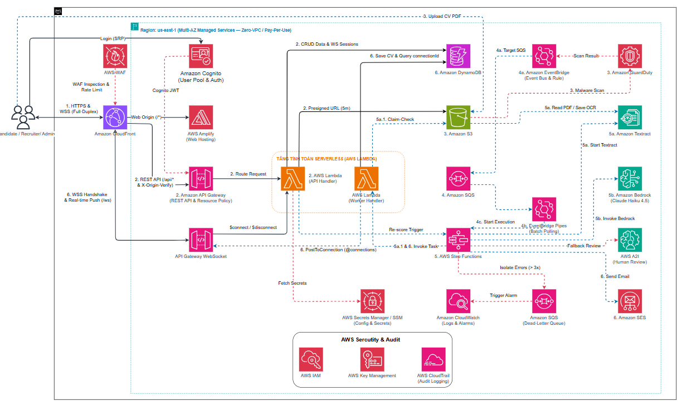

<h3 align="center">Đề tài: Cloud Job — Nền Tảng Tuyển Dụng Việc Làm Cloud Tích Hợp AI Tự Động Sàng Lọc CV</h3>

>**Cloud Job** là website nền tảng tuyển dụng chuyên biệt cho các công việc trong lĩnh vực Điện toán đám mây (Cloud Computing, DevOps, Solutions Architect, SysOps), tích hợp hệ thống AI tự động hóa toàn diện quy trình tiếp nhận, trích xuất và đánh giá hồ sơ ứng viên trên nền tảng AWS Serverless & Generative AI.

---

### 1. Tổng quan bài toán

Trong bối cảnh bùng nổ của ngành Điện toán đám mây, nhu cầu tuyển dụng các vị trí chuyên môn cao như Cloud Engineer, DevOps, SysOps và Solutions Architect ngày càng tăng mạnh. Tuy nhiên, các vị trí công việc Cloud luôn có yêu cầu khắt khe về bộ kỹ năng dịch vụ hạ tầng (AWS, Container, CI/CD, IaC) và hệ thống chứng chỉ chuyên nghiệp. Khi tiếp nhận hồ sơ, các doanh nghiệp thường gặp nhiều rào cản:
* Hồ sơ gửi về với số lượng lớn nhưng phân tán qua email hoặc form đăng ký cơ bản.
* Chuyên viên tuyển dụng hoặc Trưởng nhóm kỹ thuật phải mở từng file PDF để đọc và đánh giá thủ công từng kỹ năng kỹ thuật, kinh nghiệm dự án Cloud và chứng chỉ phù hợp.
* Quy trình này tiêu tốn hàng chục giờ làm việc mỗi tuần, dễ dẫn đến tình trạng quá tải, phản hồi chậm trễ và có nguy cơ bỏ sót nhân tài công nghệ do yếu tố mệt mỏi hoặc định kiến chủ quan.

**Hướng tiếp cận giải pháp:** Xây dựng **Cloud Job** — website nền tảng tuyển dụng chuyên biệt cho thị trường việc làm Cloud, tích hợp cổng sàng lọc hồ sơ thông minh theo kiến trúc AWS Serverless kết hợp Generative AI:
* **Giao diện Web Portal:** Cung cấp trải nghiệm trực quan cho hai đối tượng người dùng: Nhà tuyển dụng công nghệ đăng tin và quản lý ứng viên; Ứng viên ngành Cloud tìm kiếm việc làm chuyên môn và nộp hồ sơ trực tuyến.
* **Quy trình xử lý bất đồng bộ:** Khi ứng viên nộp CV định dạng PDF, file được tải trực tiếp lên kho lưu trữ an toàn Amazon S3 thông qua cơ chế Presigned URL, sau đó kích hoạt chuỗi xử lý tự động qua Amazon SQS để đảm bảo khả năng chịu tải cao và không gây nghẽn hệ thống.
* **Pipeline AI:**
  * **Amazon Textract:** Tự động trích xuất nội dung văn bản thô từ tài liệu CV định dạng PDF.
  * **Amazon Bedrock:** Sử dụng mô hình ngôn ngữ lớn Anthropic Claude Haiku 4.5 để phân tích nội dung CV dựa trên các yêu cầu cụ thể của Job Description. Mô hình tự động đối chiếu các tiêu chí kỹ năng Cloud, kinh nghiệm thực tế, chứng chỉ AWS, chấm điểm mức độ phù hợp theo thang điểm định lượng, phân tích điểm mạnh, điểm còn thiếu và tổng hợp đoạn tóm tắt nhận xét hồ sơ theo định dạng JSON có cấu trúc.
* **Tự động hóa thông báo:** Tích hợp Amazon SES để tự động gửi email xác nhận ứng tuyển đến ứng viên và hỗ trợ nhà tuyển dụng gửi thư mời phỏng vấn chỉ với một thao tác.
* **Tối ưu chi phí & Vận hành:** Toàn bộ tài nguyên đám mây hoạt động theo mô hình Serverless pay-as-you-go, không tốn chi phí duy trì máy chủ nhàn rỗi.

---

### 2. Mục tiêu & phạm vi

#### Mục tiêu cụ thể
1. **Tự động hóa quy trình sàng lọc sơ bộ:** Rút ngắn thời gian xử lý và chấm điểm 1 CV từ vài phút xuống còn **dưới 60 giây**, loại bỏ 80–90% khối lượng đọc thủ công cho nhà tuyển dụng.
2. **Nâng cao tính khách quan và nhất quán:** Áp dụng tiêu chuẩn đánh giá thống nhất cho mọi hồ sơ dựa trên yêu cầu của Job Description, hạn chế tối đa thiên kiến cá nhân.
3. **Trải nghiệm ứng viên & nhà tuyển dụng hiện đại:** Cung cấp dashboard trực quan, bảng xếp hạng ứng viên theo điểm số kèm nhận xét chi tiết, cập nhật trạng thái thời gian thực qua WebSocket Push.
4. **Hiện thực hóa chuẩn mực Cloud Architecture:** Xây dựng website Cloud Job hoàn chỉnh kết hợp hài hòa hơn 10 dịch vụ AWS, tuân thủ nghiêm ngặt 6 trụ cột của AWS Well-Architected Framework: Bảo mật, Độ tin cậy, Hiệu năng, Tối ưu chi phí, Vận hành xuất sắc và Tính bền vững.

#### Phạm vi triển khai

* **Phạm vi MVP (Cốt lõi):**
  * **Xác thực & Tổ chức:** Quản lý tài khoản qua Amazon Cognito với 3 nhóm vai trò (`Candidate`, `Recruiter`, `Admin`); hỗ trợ Company Profile cho phép nhiều thành viên HR cùng làm việc chung.
  * **Quản lý tuyển dụng & Ứng tuyển:** Nhà tuyển dụng đăng, chỉnh sửa, đóng tin tuyển dụng; Ứng viên tìm kiếm việc làm, quản lý hồ sơ cá nhân và CV mặc định.
  * **Tiếp nhận hồ sơ PDF chuẩn hóa:** Hỗ trợ duy nhất định dạng chuẩn PDF tối đa 5MB tải trực tiếp lên Amazon S3 qua Presigned URL an toàn; cơ chế chống nộp trùng và quyền rút đơn ứng tuyển; theo dõi song song 2 vòng đời trạng thái: trạng thái tuyển dụng và trạng thái xử lý ngầm.
  * **Pipeline AI khách quan:** Xử lý bất đồng bộ qua Amazon SQS và AWS Lambda Worker; trích xuất văn bản qua Amazon Textract; tự động loại bỏ dữ liệu định danh cá nhân trước khi gọi Amazon Bedrock Claude Haiku 4.5 chấm điểm theo Rubric 100 điểm chuẩn hóa xuất JSON có cấu trúc.
  * **Đánh giá Human-in-the-Loop:** Giao diện đối chiếu song song 3 cột Side-by-side Review; Recruiter ghi chú nội bộ, cho điểm sao và cập nhật trạng thái kèm nhật ký kiểm toán bất biến; hỗ trợ chấm lại có kiểm soát tần suất.
  * **Báo cáo & Tái sử dụng nguồn lực:** Báo cáo phân tích khoảng trống kỹ năng Skill Gap; xây dựng Kho dữ liệu tài năng Talent Pool và tự động gợi ý ứng viên cũ phù hợp cho tin tuyển dụng mới.
  * **Bảo vệ quyền riêng tư & Vận hành:** Quản lý sự đồng ý theo mục đích và thực thi quyền chủ thể dữ liệu DSR Anonymization; cam kết không sử dụng dữ liệu để huấn luyện lại mô hình trên Bedrock; gửi email tự động qua Amazon SES; thu thập logs tập trung, dashboard chỉ số và cảnh báo tự động qua Amazon CloudWatch; kịch bản dọn dẹp tài nguyên triệt để sau thử nghiệm.
* **Phạm vi mở rộng:**
  * Ứng viên lưu việc làm yêu thích.
  * Đăng ký nhận thông báo việc làm phù hợp định kỳ qua email.
  * Bộ lọc tìm kiếm nâng cao đa chiều theo mức lương chi tiết, loại hình làm việc Remote/Hybrid.
  * Tích hợp AWS WAF bảo vệ CloudFront & API Gateway chống tấn công web phổ biến.

---

### 3. Vấn đề cần giải quyết

#### Thách thức và hạn chế trong quy trình hiện tại
* **Tắc nghẽn quy trình:** Một đợt tuyển dụng trung bình tiếp nhận từ 100 đến 300 hồ sơ. Việc đọc, phân loại và ghi chép thủ công tiêu tốn trung bình 15 – 25 giờ làm việc cho mỗi vị trí.
* **Thời gian phản hồi chậm:** Ứng viên thường phải chờ từ 1 đến 3 tuần mới nhận được phản hồi sơ loại, dễ dẫn đến mất ứng viên tiềm năng vào tay đối thủ.
* **Thiếu chuẩn hóa:** Không có thang điểm đo lường rõ ràng; các đánh giá ghi chú thường tản mác và khó so sánh trực quan giữa các ứng viên.
* **Chi phí phần mềm bên ngoài quá cao:** Các giải pháp phần mềm quản lý tuyển dụng thương mại trên thị trường đòi hỏi chi phí định kỳ đắt đỏ từ 100 đến 500 USD/tháng, vượt quá mức cần thiết cho các phòng ban nhỏ hoặc các dự án tuyển dụng ngắn hạn.

#### Hiệu quả thực tế và phương án tối ưu chi phí
* **Tiết kiệm thời gian:** Giảm hơn **80% thời gian** duyệt hồ sơ ban đầu. Nhà tuyển dụng chỉ cần tập trung rà soát nhóm ứng viên top đầu do hệ thống đề xuất.
* **Chi phí hạ tầng siêu tiết kiệm:** Ứng dụng kiến trúc Serverless pay-as-you-go giúp chi phí vận hành thử nghiệm chỉ khoảng **1,00 – 2,00 USD / tháng**, và chỉ khoảng **28 USD / tháng** khi xử lý tới 2.000 CV.
* **Thời gian hoàn vốn:** Mang lại hiệu quả ngay từ tháng đầu tiên vận hành nhờ tiết kiệm hàng chục giờ công lao động của nhân sự tuyển dụng và chuyên gia kỹ thuật.

---

### 4. Kiến trúc giải pháp sơ bộ

<em>Sơ đồ kiến trúc tổng thể giải pháp Cloud Job Pure Serverless trên AWS (Multi-AZ Managed Services — Zero-VPC / Pay-Per-Use)</em>

Hệ thống được thiết kế theo mô hình kiến trúc phân tầng 100% Serverless, tách rời tuyệt đối giữa luồng tiếp nhận đồng bộ qua API và luồng xử lý AI bất đồng bộ qua EventBridge Pipes và Step Functions Claim-Check Pattern:

#### Danh mục dịch vụ AWS chính thức

| Dịch vụ AWS | Phân loại | Vai trò kỹ thuật trong hệ thống |
| :--- | :--- | :--- |
| **AWS WAF** | Edge Security | Bảo vệ biên ứng dụng chống SQL Injection, XSS, HTTP Flood, Bot độc hại và lạm dụng tần suất qua Global WebACL gắn trên CloudFront. |
| **Amazon CloudFront** | Global Edge CDN | Cửa ngõ biên hợp nhất phân phối Web SPA từ Amplify, chuyển tiếp REST API và nâng cấp WebSocket Handshake với TLS 1.3. |
| **AWS Amplify Hosting** | Frontend Hosting | Lưu trữ và tự động triển khai CI/CD từ GitHub cho giao diện React Vite SPA. |
| **Amazon Cognito** | Identity Management | Quản lý đăng ký, đăng nhập và phân quyền RBAC cho 3 vai trò (Candidate, Recruiter, Admin) kèm thuộc tính công ty. |
| **Amazon API Gateway** | API Gateway | **REST API** khóa cứng bằng Resource Policy và Cognito JWT Authorizer; **WebSocket API** đẩy thông báo kết quả chấm điểm thời gian thực trực tiếp lên UI thay thế hoàn toàn cơ chế Polling. |
| **AWS Lambda** | Serverless Compute | Thực thi business logic backend: xác minh quyền, cấp Presigned URL, kiểm tra Idempotency, khử PII và kiểm tra tính hợp lệ của JSON trên Node.js TypeScript. |
| **Amazon S3** | Object Storage | Lưu trữ cách ly tệp CV PDF tối đa 5MB, phân vùng theo trạng thái kiểm định an toàn và hỗ trợ cấp quyền tải lên trực tiếp bằng Presigned URL thời hạn 5 phút. |
| **Amazon GuardDuty** | Threat Detection | Tự động quét mã độc với tính năng Malware Protection for S3 ngay khi tệp CV được tải lên, đảm bảo an toàn trước khi cho phép kích hoạt xử lý tiếp theo. |
| **Amazon SQS** | Message Queue | Hàng đợi đệm chống nghẽn đột biến, kiểm tra khóa chống trùng lặp theo document_id trước khi kích hoạt Step Functions. |
| **Amazon SQS Dead-Letter Queue** | Error Isolation | Hàng đợi cách ly và lưu trữ các thông điệp lỗi sau 3 lần thử lại thất bại để bảo toàn dữ liệu và phục vụ điều tra nguyên nhân. |
| **Amazon EventBridge** | Event Routing | Bộ định tuyến sự kiện tiếp nhận thông báo quét sạch mã độc từ GuardDuty để kích hoạt quy trình xử lý tiếp theo. |
| **Amazon EventBridge Pipes** | Event Integration | Kết nối trực tiếp hàng đợi Amazon SQS tới AWS Step Functions kèm bộ lọc và chuyển đổi payload tự động. |
| **AWS Step Functions** | Workflow Orchestrator | Điều phối tuần tự: Amazon Textract $	o$ Khử PII $	o$ Amazon Bedrock Claude Haiku 4.5 chấm Rubric 100 điểm, kèm cơ chế thử lại tự động. |
| **Amazon Textract** | AI Document OCR | Đọc trực tiếp tệp PDF từ S3, hỗ trợ trích xuất văn bản bất đồng bộ cho tài liệu nhiều trang mà không làm nghẽn kết nối mạng. |
| **Amazon Bedrock Runtime** | Generative AI | Chạy mô hình Anthropic Claude Haiku 4.5 để chuẩn hóa CV thành cấu trúc JSON theo Rubric 100 điểm, bọc thẻ XML chống Prompt Injection. |
| **Amazon A2I** | Human-in-the-Loop | Nhánh rẽ dự phòng trong Step Functions khi điểm tin cậy của Textract dưới 80% hoặc Bedrock trả về JSON sai định dạng, chuyển hồ sơ sang hàng đợi chờ HR đánh giá thủ công. |
| **Amazon DynamoDB** | NoSQL Database | Cơ sở dữ liệu Single-Table On-Demand độ trễ thấp, lưu dữ liệu CV JSON có cấu trúc, khóa chống trùng lặp và bảng xếp hạng ứng viên. |
| **Amazon SES** | Email Communication | Tự động gửi email biên nhận nộp đơn, thông báo kết quả phân tích CV và thư mời phỏng vấn. |
| **Amazon CloudWatch** | Observability | Thu thập logs tập trung, theo dõi chỉ số hiệu năng thời gian thực và kích hoạt cảnh báo khi phát sinh lỗi hoặc ứ đọng hàng đợi. |
| **AWS KMS** | Data Encryption | Quản lý và bảo vệ khóa mã hóa Customer Managed Key cho dữ liệu lưu trữ tại Amazon S3 và Amazon DynamoDB. |

#### 4 Trụ cột Kỹ thuật Tạo nên Sự Khác biệt
1. **Tiếp nhận cách ly & Quét mã độc tự động:** Chỉ cấp Presigned URL cho tài nguyên đã xác minh với khóa tệp do máy chủ tạo; mọi tệp CV mới đều đi qua vùng cách ly S3 Quarantine và được quét mã độc tự động bằng Amazon GuardDuty trước khi xử lý.
2. **Điều phối tuần tự Textract $\to$ Bedrock JSON và nhánh dự phòng Amazon A2I:** AWS Step Functions áp dụng Claim-Check Pattern chống tràn kích thước gói tin; điều phối Textract OCR và Bedrock chuẩn hóa CV thành JSON Rubric 100 điểm, tự động chuyển sang hàng đợi đánh giá thủ công nếu điểm tin cậy thấp hoặc cấu trúc JSON không hợp lệ.
3. **Chống trùng lặp sự kiện & Phản hồi thời gian thực qua WebSocket Push:** Khóa chống trùng lặp theo mã định danh tài liệu ngăn ngừa xử lý lặp khi S3 phát sinh sự kiện nhiều lần; kết quả chấm điểm được đẩy trực tiếp lên giao diện người dùng qua API Gateway WebSocket.
4. **Kiến trúc Pure Serverless tối ưu chi phí mạng:** Loại bỏ hoàn toàn chi phí cố định của VPC, NAT Gateway và Interface PrivateLink; bảo vệ toàn diện bằng IAM Zero-Trust và TLS 1.3 trên AWS Global Backbone với chi phí mạng cố định bằng 0 USD/tháng.

---

### 5. Kế hoạch & Timeline thực hiện

Lộ trình phát triển hệ thống kéo dài trong 9 tuần (từ 27/10/2026 đến 31/12/2026), triển khai song song giữa hạ tầng AWS IaC và ứng dụng Web React Vite qua 7 giai đoạn bám sát các mốc kiểm soát chất lượng chính:

| Giai đoạn | Thời gian | Trọng tâm Cấu hình Dịch vụ AWS | Trọng tâm Xây dựng Website & Mốc kiểm soát |
| :---: | :---: | :--- | :--- |
| **Phase 0** Phân tích & Thiết kế | 27/10 – 31/10 | Đặc tả yêu cầu kỹ thuật, chốt kiến trúc Serverless, thiết kế cơ sở dữ liệu DynamoDB, API Spec và Rubric 100 điểm; lập dự toán chi phí AWS Pricing Calculator. | **Mốc M0 (31/10):** Hoàn thành tài liệu SRS, sơ đồ kiến trúc, thiết kế API, cơ sở dữ liệu và bản Proposal. |
| **Phase 1** Nền tảng, Mạng & Auth | 01/11 – 08/11 | Khởi tạo AWS CDK/SAM; cấu hình Cognito với 3 nhóm vai trò, S3 Quarantine, SQS, DLQ, CloudFront, AWS WAF và Amplify Hosting. | Dựng khung React Vite, hoàn thiện màn hình Danh sách việc làm và Đăng nhập, đăng ký phân quyền. **Mốc M1 (08/11):** Hạ tầng mạng, xác thực và khung website hoạt động ổn định trên Cloud. |
| **Phase 2** Nghiệp vụ & Tiếp nhận CV | 09/11 – 22/11 | Xây dựng API Gateway REST và Lambda quản lý Company Profile, tin tuyển dụng, cấp Presigned URL; cấu hình S3 CV Quarantine, GuardDuty Malware Protection và hàng đợi SQS chống trùng lặp. | Hoàn thiện luồng ứng viên: Upload PDF trực tiếp lên S3 Quarantine, theo dõi trạng thái kép và quyền rút đơn; giao diện quản lý tin của Recruiter. **Mốc M2 (22/11):** Hoàn chỉnh luồng đăng tin, nộp CV an toàn qua vùng cách ly. |
| **Phase 3** Step Functions AI & A2I | 23/11 – 06/12 | Cấu hình Step Functions điều phối: Textract OCR $\to$ Lọc PII $\to$ Bedrock Claude Haiku 4.5 chuẩn hóa CV thành JSON Rubric 100 điểm; cấu hình thử lại tự động và nhánh Amazon A2I Fallback. | Xây dựng giao diện Recruiter: Bảng xếp hạng ứng viên, giao diện đối chiếu song song 3 cột Side-by-side Review kèm chế độ đánh giá thủ công A2I, và Kho tài năng Talent Pool. **Mốc M3 (06/12):** Pipeline AI chấm điểm tự động và giao diện đánh giá hoàn tất. |
| **Phase 4** WebSocket, SES & Admin | 07/12 – 13/12 | Triển khai API Gateway WebSocket đẩy kết quả chấm điểm thời gian thực dưới 500ms; tích hợp Amazon SES gửi email tự động; triển khai hủy định danh dữ liệu DSR và CloudWatch Dashboard, Alarms. | Tích hợp WebSocket Push trên giao diện, hoàn thiện màn hình quản trị hệ thống Admin, giám sát hàng đợi lỗi và phê duyệt quyền riêng tư. **Mốc M4 (13/12):** Hoàn thành tích hợp toàn bộ dịch vụ AWS và giao diện website. |
| **Phase 5** Kiểm thử & Đóng băng | 14/12 – 20/12 | Kiểm thử toàn diện: S3 Quarantine, chống trùng lặp, cơ chế thử lại Step Functions, A2I Fallback, WebSocket Push, chống Prompt Injection và tải đồng thời 50 CV; đối chiếu chi phí thực tế. | Kiểm thử End-to-End trên toàn bộ giao diện website; đóng băng tính năng và gắn tag release phiên bản chính thức. **Mốc M5 (20/12):** Toàn bộ test case đạt chuẩn, sẵn sàng demo. |
| **Phase 6** Tài liệu & Nộp bài | 21/12 – 31/12 | Soạn thảo bộ Lab Guide song ngữ chi tiết đảm bảo tính tái lập; hoàn thiện script dọn dẹp tài nguyên tự động đưa chi phí về 0 USD sau khi xóa stack. | Quay video demo các phân cảnh thực tế gồm Step Functions và WebSocket Push; hoàn thiện hồ sơ nộp bài chính thức. **Mốc M6 (31/12):** Hoàn thiện hồ sơ bài nộp. |

---

### 6. Bảng dự toán ngân sách & chi phí (Cost Estimation)

Dự toán chi phí được tính toán độc lập và đối chiếu kết quả chính thức từ công cụ **AWS Pricing Calculator** tại Region **`us-east-1`** trên 2 kịch bản vận hành thực tế:
* **Kịch bản A (Demo / Workshop):** 5 tin tuyển dụng, **100 hồ sơ CV PDF/tháng** (trung bình 2 trang/CV), 2.500 requests API, tắt WAF.
* **Kịch bản B (Doanh nghiệp vừa - Production SMB):** 50 tin tuyển dụng, **2.000 hồ sơ CV PDF/tháng** (4.000 trang Textract OCR, ~5M input / ~1.6M output tokens Claude Haiku 4.5, 50.000 requests API), bật AWS WAF bảo vệ.

#### Bảng tổng hợp chi phí hàng tháng

| Nhóm dịch vụ AWS | Kịch bản A (Demo 100 CV) | Kịch bản B (SMB 2.000 CV) | Cơ sở tính toán & Free Tier |
| :--- | :---: | :---: | :--- |
| **AWS Lambda** | **$0.00** | **$0.00** | Nằm trọn trong Free Tier vĩnh viễn: 1 triệu requests và 400.000 GB-s/tháng. |
| **Amazon API Gateway** | **$0.01** | **$0.19** | REST API ($3.50/1M reqs) kết hợp WebSocket ($0.25/1M phút và $1.00/1M messages). |
| **Amazon CloudFront** | **$0.00** | **$0.00** | Miễn phí vĩnh viễn 1 TB truyền dữ liệu ra ngoài và 10 triệu requests/tháng. |
| **AWS WAF** | **$0.00** *(Tắt)* | **$0.03** | Chi phí kiểm tra request theo khối lượng thực tế. |
| **Amazon Cognito** | **$0.00** | **$0.01** | Miễn phí vĩnh viễn 50.000 người dùng hoạt động hàng tháng. |
| **Amazon S3** | **$0.04** | **$0.23** | Lưu trữ Standard S3, vòng đời Lifecycle tự động dọn dẹp sau 90 ngày. |
| **GuardDuty S3 Malware** | **$0.11** | **$0.79** | Đơn giá 0.20 USD / GB dữ liệu CV quét tự động. |
| **Amazon SQS** | **$0.00** | **$0.02** | Nằm trọn trong Free Tier 1 triệu requests SQS hàng tháng. |
| **Amazon EventBridge Pipes** | **$0.00** | **$0.02** | Kéo tin từ SQS kích hoạt Step Functions qua Pipes. |
| **AWS Step Functions** | **$0.00** | **$0.30** | Demo nằm trong Free Tier 4.000 state transitions; SMB tính phí vượt mức tối thiểu. |
| **Amazon Textract** | **$0.30** | **$6.00** | Đơn giá DetectDocumentText: 1.50 USD / 1.000 trang tài liệu PDF. |
| **Amazon Bedrock (Haiku 4.5)** | **$11.70** | **$11.70** | Claude Haiku 4.5 theo lượng token xử lý thực tế bóc tách và chấm điểm. |
| **Amazon DynamoDB** | **$0.51** | **$1.25** | Chế độ On-Demand, tận dụng 25GB lưu trữ miễn phí vĩnh viễn. |
| **Amazon SES** | **$0.01** | **$0.30** | Gửi email thông báo kết quả ứng tuyển và thư mời phỏng vấn. |
| **AWS KMS** | **$1.06** | **$1.15** | 1 Customer Managed Key bảo vệ mã hóa dữ liệu. |
| **Amazon CloudWatch** | **$1.31** | **$2.82** | Lưu trữ logs hệ thống kết hợp các bộ cảnh báo Alarms tiêu chuẩn. |
| **AWS Amplify Hosting** | **$1.27** | **$2.87** | Thời lượng build frontend và phân phối ứng dụng tĩnh. |
| **AWS Secrets Manager** | **$0.40** | **$0.40** | Lưu trữ an toàn các thông tin cấu hình nhạy cảm. |
| **A2I, CloudTrail, IAM** | **$0.00** | **$0.00** | Miễn phí theo chính sách của AWS. |
| **TỔNG CHI PHÍ HÀNG THÁNG** | **$18.63 USD** | **$28.08 USD** | **Tiết kiệm 80% – 88% so với kiến trúc VPC truyền thống (115 – 148 USD/tháng)** |

* **Hiệu quả kinh tế trên mỗi hồ sơ ứng viên:**
  * Tại quy mô doanh nghiệp vừa (2.000 CV/tháng), tổng chi phí AWS để xử lý trọn vẹn một hồ sơ từ upload, quét mã độc, bóc tách OCR, chấm điểm AI đến gửi email và cập nhật real-time chỉ khoảng **~0.014 USD (~350 VNĐ / CV)**.
  * So với chi phí nhân sự duyệt tay truyền thống (15.000 – 30.000 VNĐ cho mỗi 5–10 phút đọc CV của HR), hệ thống giúp **tiết kiệm hơn 98% chi phí tuyển dụng ban đầu**.
* **Chiến lược kiểm soát ngân sách:** Cấu hình **AWS Budgets** cảnh báo qua email tại các ngưỡng **10 USD** (cho bản Demo) và **35 USD/tháng** (cho bản SMB), đảm bảo an toàn tài chính tuyệt đối.

---

### 7. Rủi ro & phương án giảm thiểu

| Rủi ro tiềm ẩn | Mức độ ảnh hưởng | Xác suất | Chiến lược giảm thiểu | Kế hoạch dự phòng |
| :--- | :---: | :---: | :--- | :--- |
| **Chưa được cấp quyền truy cập Model Bedrock ở Region đã chọn** | **Cao** | **Trung bình** | Kiểm tra danh mục model có sẵn và gửi yêu cầu cấp quyền ngay trong Phase 0; ưu tiên chọn region `us-east-1` có đầy đủ các model. | Chuẩn bị prompt linh hoạt tương thích với cả mô hình Anthropic Claude lẫn Amazon Titan. |
| **Hạn chế của Amazon SES Sandbox** | **Trung bình** | **Cao** | Xác thực trước các địa chỉ email dùng trong kịch bản kiểm thử và demo ngay từ Phase 1. | Ghi chú rõ điều kiện tiên quyết trong tài liệu hướng dẫn; hỗ trợ xuất thông báo ra log console nếu email chưa được xác thực. |
| **File CV lỗi, PDF dạng ảnh scan mờ hoặc quá nhiều trang** | **Trung bình** | **Trung bình** | Giới hạn định dạng file duy nhất PDF dung lượng tối đa 5MB; cấu hình thời gian chờ và bắt lỗi ngoại lệ trong Lambda trích xuất; hiển thị trạng thái thất bại kèm nguyên nhân rõ ràng. | Đẩy các bản tin lỗi xử lý quá số lần quy định vào Dead-Letter Queue để phân tích nguyên nhân mà không làm nghẽn hệ thống. |
| **Tấn công Prompt Injection từ nội dung CV** | **Trung bình** | **Thấp** | Thiết kế prompt chặt chẽ, cô lập hoàn toàn phần dữ liệu CV trong thẻ phân cách XML `<cv_content>`; áp dụng system prompt yêu cầu model chỉ đóng vai trò giám khảo khách quan và không thực thi mệnh lệnh bên trong CV. | Thử nghiệm các test case có chủ đích chèn lệnh phá hoại trong Phase 5 để hoàn thiện prompt phòng vệ. |
| **Phát sinh chi phí đám mây ngoài ý muốn** | **Trung bình** | **Thấp** | Cấu hình AWS Budgets cảnh báo qua email ở các mốc 5 USD và 10 USD ngay từ đầu; đặt vòng đời dữ liệu S3 Lifecycle tự hủy CV sau 30–90 ngày. | Xây dựng script hủy toàn bộ tài nguyên bằng một câu lệnh để người thực hành xóa sạch hạ tầng sau khi hoàn tất kiểm thử. |
