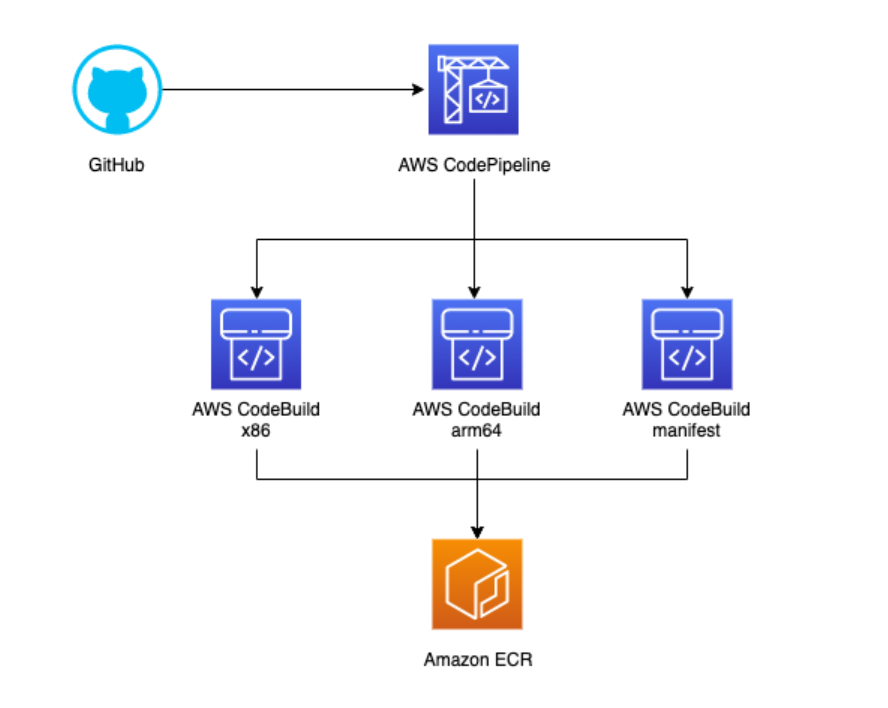

<h2 align="center">AWS CODEBUILD COMBINED WITH CODEPIPELINE – EXPLORING HOW TO BUILD CI/CD PIPELINES ON AWS</h2>

During software development, whenever source code changes occur, developers frequently have to perform repetitive manual tasks: installing dependencies, building the application, running test suites, and deploying new releases. When handled manually, this release process is not only time-consuming but also prone to human error.

While exploring AWS and DevOps solutions, I became interested in automating this workflow using CI/CD. Among AWS services supporting CI/CD, AWS CodeBuild and AWS CodePipeline can be effectively combined to build a comprehensive automation pipeline.

What is fascinating is that these two services serve distinct, complementary roles: CodePipeline orchestrates workflow stages, while CodeBuild executes concrete tasks such as building source code, executing tests, and packaging artifacts.

### AWS CodePipeline – Orchestrating the Entire CI/CD Workflow

CodePipeline is AWS's fully managed CI/CD service designed to automate release pipeline stages. Instead of writing custom glue scripts to connect each phase, developers define a cohesive pipeline composed of Stages and Actions.

A typical pipeline generally contains three primary stages:
* **Source:** Fetches source code from repositories such as GitHub or AWS CodeCommit.
* **Build:** Compiles the application, installs dependencies, and runs automated tests.
* **Deploy:** Delivers the updated application artifact to the target deployment environment.

A key highlight of CodePipeline is its ability to seamlessly integrate various AWS services and external developer tools into a unified execution flow. When changes are pushed to the repository, the pipeline triggers automatically and executes stages in configured order.

Furthermore, CodePipeline provides real-time status tracking for each Stage and Action. If a step fails, you can immediately pinpoint the exact point of failure without manually debugging the entire release process.

### AWS CodeBuild – Automating Build and Testing Workflows

If CodePipeline acts as the coordinator, CodeBuild is the workhorse that performs the actual build and test execution.

AWS CodeBuild is a fully managed build service providing scalable compute environments on-demand, eliminating the need to provision, patch, and maintain dedicated build servers.

A core component when working with CodeBuild is the `buildspec.yml` file. This YAML configuration file defines commands and settings executed during each build phase.

A typical buildspec is structured into distinct phases:
* **install:** Installs the required runtime environments and build dependencies.
* **pre_build:** Prepares the environment, configures runtime parameters, or logs in to container registries.
* **build:** Compiles source code, runs automated tests, or packages the application.
* **post_build:** Executes post-build operations such as pushing Docker images or generating output artifacts.

This structure is highly intuitive because the entire build lifecycle is version-controlled directly alongside the source code. Modifying build steps merely requires updating the buildspec file rather than logging into build servers to reconfigure environments.

### How Do CodeBuild and CodePipeline Work Together?

To understand how these services cooperate, consider a standard application deployment scenario leveraging GitHub, AWS CodePipeline, CodeBuild, Amazon ECR, and Amazon ECS.

When a developer pushes commits to GitHub, CodePipeline detects the change and initiates a new execution. The Source Stage retrieves the corresponding commit revision and passes the output artifact to the Build Stage.

Here, CodeBuild executes instructions defined in `buildspec.yml`: installing dependencies, running unit tests, building the Docker image, and pushing it to Amazon ECR.

Once the build phase succeeds, the pipeline progresses to the Deploy Stage to update the service on Amazon ECS. In a standard ECS deployment workflow, CodePipeline consumes an `imagedefinitions.json` artifact to determine the newly deployed container image URI.

Crucially, if the Build Stage fails, the pipeline halts immediately, preventing unverified or broken changes from ever reaching production environments.

### A Notable Concept: Artifacts in CodePipeline

Understanding the concept of Artifacts is essential, as they represent the data exchange mechanism between pipeline stages.

An artifact is simply the input or output dataset of a pipeline Action. For instance, the Source Stage produces an artifact containing raw source code; the Build Stage receives this input, executes the build, and generates an output artifact containing `imagedefinitions.json` for consumption by the Deploy Stage.

Artifacts are securely persisted in an artifact store, typically backed by Amazon S3. This decoupling allows stages to operate independently while maintaining an integrated, reproducible pipeline.

### Key Considerations for Real-World Implementations

Constructing robust CI/CD pipelines involves several practical design considerations beyond connecting stages:

* **IAM Permissions:** CodePipeline and CodeBuild require appropriate IAM roles to interact with source repositories, S3, ECR, and target infrastructure, adhering strictly to the Principle of Least Privilege.
* **Secrets Management:** Sensitive information such as API keys, database credentials, and tokens must never be hardcoded into source repositories or buildspec files. Instead, retrieve them dynamically from AWS Secrets Manager or Systems Manager Parameter Store.
* **Monitoring & Observability:** CodeBuild integrates natively with Amazon CloudWatch Logs to capture all build logs, simplifying troubleshooting for dependency failures, broken tests, or packaging errors.
* **Build Optimization:** Utilize CodeBuild caching mechanisms, select optimal compute types, and optimize Docker layer caching to reduce execution latency and minimize build costs.

For containerized workloads, configuring the CodeBuild environment properly, granting ECR push permissions, and implementing traceable Docker image tagging strategies ensure reliable auditability back to the specific source commit.

### Conclusion

AWS CodeBuild and AWS CodePipeline are complementary services that form a powerful backbone for automated software delivery:
* **CodePipeline:** Organizes, automates, and orchestrates CI/CD release stages.
* **CodeBuild:** Provides fully managed, isolated compute power to execute build and test tasks.

When combined with Amazon ECR and Amazon ECS, teams can establish an automated, reliable pipeline spanning from initial code push all the way to production deployment.

### References

* AWS CodePipeline: [https://docs.aws.amazon.com/codepipeline/latest/userguide/welcome.html](https://docs.aws.amazon.com/codepipeline/latest/userguide/welcome.html)
* AWS CodeBuild: [https://docs.aws.amazon.com/codebuild/latest/userguide/welcome.html](https://docs.aws.amazon.com/codebuild/latest/userguide/welcome.html)
* Buildspec Reference: [https://docs.aws.amazon.com/codebuild/latest/userguide/build-spec-ref.html](https://docs.aws.amazon.com/codebuild/latest/userguide/build-spec-ref.html)
* CodeBuild Action in CodePipeline: [https://docs.aws.amazon.com/codepipeline/latest/userguide/action-reference-CodeBuild.html](https://docs.aws.amazon.com/codepipeline/latest/userguide/action-reference-CodeBuild.html)
* Deploying to Amazon ECS with CodePipeline: [https://docs.aws.amazon.com/codepipeline/latest/userguide/ecs-cd-pipeline.html](https://docs.aws.amazon.com/codepipeline/latest/userguide/ecs-cd-pipeline.html)

#AWS #AWSCodeBuild #AWSCodePipeline #CICD #DevOps #AmazonECR #AmazonECS #CloudComputing #AWSStudyGroup

Original Post Link: [https://www.facebook.com/groups/awsstudygroupfcj/permalink/2332668324164793/](https://www.facebook.com/groups/awsstudygroupfcj/permalink/2332668324164793/)
