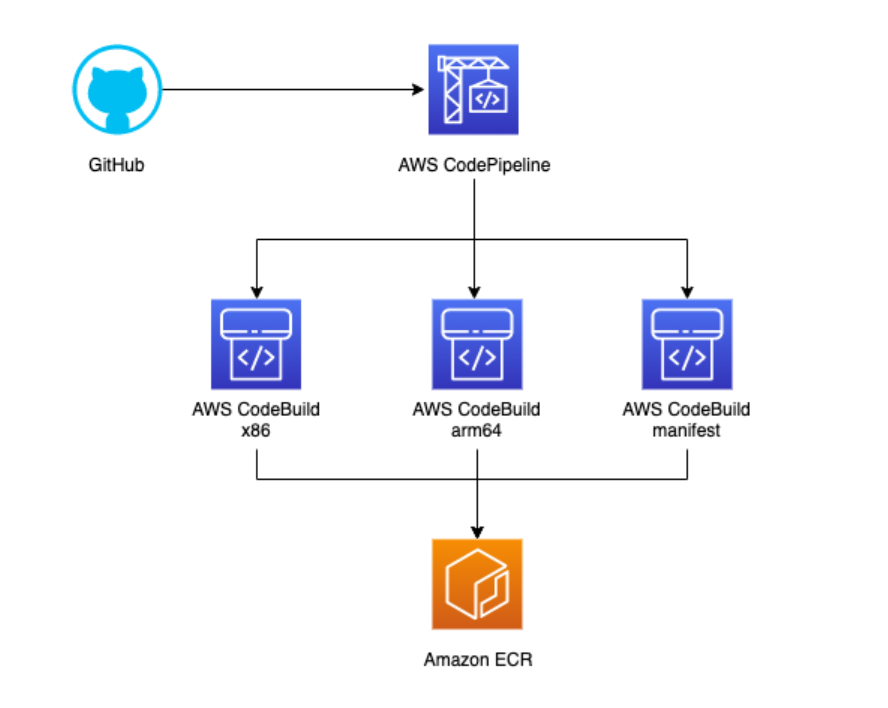

<h2 align="center">AWS CODEBUILD KẾT HỢP CODEPIPELINE – TÌM HIỂU CÁCH XÂY DỰNG CI/CD PIPELINE TRÊN AWS</h2>

Trong quá trình phát triển phần mềm, mỗi khi có thay đổi trong source code, developer thường phải thực hiện một loạt công việc như cài đặt dependencies, build ứng dụng, chạy kiểm thử và triển khai phiên bản mới. Nếu thực hiện tất cả các bước này theo cách thủ công, quy trình phát hành không chỉ mất thời gian mà còn dễ xảy ra sai sót.

Khi tìm hiểu về AWS và các giải pháp DevOps, mình bắt đầu quan tâm đến cách tự động hóa quy trình này thông qua CI/CD. Trong số các dịch vụ AWS hỗ trợ CI/CD, AWS CodeBuild và AWS CodePipeline là hai dịch vụ có thể kết hợp để xây dựng một quy trình tự động hóa tương đối hoàn chỉnh.

Điều mình thấy thú vị là hai dịch vụ này không thực hiện cùng một nhiệm vụ. CodePipeline chịu trách nhiệm điều phối các bước trong quy trình, còn CodeBuild đảm nhiệm việc thực thi các công việc như build source code, chạy test và đóng gói ứng dụng.

### AWS CodePipeline – Điều phối toàn bộ quy trình CI/CD

CodePipeline là dịch vụ CI/CD được AWS cung cấp nhằm tự động hóa các giai đoạn trong quá trình phát hành phần mềm. Thay vì phải tự viết script để kết nối từng công đoạn, mình có thể định nghĩa một pipeline gồm nhiều Stage và Action.

Một pipeline thông thường có thể bao gồm ba giai đoạn chính:
* **Source:** Lấy source code từ repository như GitHub hoặc AWS CodeCommit.
* **Build:** Biên dịch ứng dụng, cài đặt dependencies và chạy kiểm thử.
* **Deploy:** Đưa phiên bản ứng dụng mới lên môi trường triển khai.

Điểm mình quan tâm ở CodePipeline là khả năng kết nối nhiều dịch vụ AWS và các công cụ bên ngoài thành một luồng xử lý thống nhất. Khi có thay đổi trong repository, pipeline có thể tự động được kích hoạt và lần lượt thực hiện các giai đoạn đã cấu hình.

Ngoài ra, CodePipeline còn hỗ trợ theo dõi trạng thái của từng Stage và Action. Nếu một bước thất bại, mình có thể xác định được vị trí xảy ra lỗi thay vì phải kiểm tra thủ công toàn bộ quy trình.

### AWS CodeBuild – Tự động hóa quá trình Build và Testing

Nếu CodePipeline là thành phần điều phối thì CodeBuild chính là nơi thực hiện các công việc build và kiểm thử.

AWS CodeBuild là dịch vụ build được quản lý hoàn toàn. Dịch vụ này cung cấp môi trường tính toán để thực thi các lệnh cần thiết mà không phải tự thiết lập và duy trì máy chủ build.

Một trong những thành phần quan trọng nhất khi làm việc với CodeBuild là file `buildspec.yml`. Đây là file cấu hình YAML mô tả những công việc cần thực hiện trong quá trình build.

Buildspec thường được chia thành các phase:
* **install:** Cài đặt runtime và các công cụ cần thiết.
* **pre_build:** Chuẩn bị môi trường, thiết lập cấu hình hoặc đăng nhập vào container registry.
* **build:** Thực hiện biên dịch source code, chạy test hoặc đóng gói ứng dụng.
* **post_build:** Thực hiện các công việc sau build như push Docker Image hoặc tạo artifact đầu ra.

Mình thấy cách tổ chức này khá trực quan vì toàn bộ quy trình build được định nghĩa trong một file cấu hình và có thể quản lý cùng source code. Khi cần thay đổi các bước build, developer chỉ cần cập nhật buildspec thay vì phải chỉnh sửa thủ công trên máy chủ.

### Khi kết hợp CodeBuild và CodePipeline, quy trình hoạt động như thế nào?

Để hiểu rõ hơn cách hai dịch vụ phối hợp, mình tìm hiểu một kịch bản triển khai ứng dụng sử dụng GitHub, AWS CodePipeline, CodeBuild, Amazon ECR và Amazon ECS.

Khi developer push code lên GitHub, CodePipeline sẽ nhận biết thay đổi và bắt đầu một execution mới. Source Stage lấy phiên bản source code tương ứng, sau đó chuyển dữ liệu sang Build Stage.

Tại đây, CodeBuild thực hiện các công việc được định nghĩa trong `buildspec.yml`: cài đặt dependencies, chạy kiểm thử, build Docker Image và push image lên Amazon ECR.

Sau khi quá trình build thành công, pipeline chuyển sang Deploy Stage để cập nhật phiên bản ứng dụng trên Amazon ECS. Với phương thức triển khai ECS tiêu chuẩn, CodePipeline có thể sử dụng file `imagedefinitions.json` để xác định container image mới cần triển khai.

Điểm quan trọng là nếu Build Stage thất bại, pipeline sẽ không tiếp tục triển khai phiên bản đó. Điều này giúp hạn chế nguy cơ đưa những thay đổi chưa vượt qua bước kiểm thử lên môi trường chạy thực tế.

### Một khái niệm đáng chú ý: Artifact trong CodePipeline

Trong quá trình tìm hiểu, mình cũng chú ý đến khái niệm Artifact vì đây là cơ chế giúp các Stage trao đổi dữ liệu với nhau.

Artifact có thể hiểu là dữ liệu đầu vào hoặc đầu ra của một Action trong pipeline. Chẳng hạn, Source Stage tạo artifact chứa source code, Build Stage tiếp nhận dữ liệu này để thực hiện build, sau đó xuất ra artifact chứa file `imagedefinitions.json` cho Deploy Stage sử dụng.

Các artifact được lưu trữ trong artifact store, thường là Amazon S3. Nhờ đó, các giai đoạn có thể hoạt động độc lập mà vẫn trao đổi dữ liệu theo một quy trình thống nhất.

### Một số điều cần quan tâm khi triển khai thực tế

Qua việc tìm hiểu hai dịch vụ, mình nhận thấy việc xây dựng CI/CD Pipeline không chỉ đơn giản là kết nối các Stage với nhau. Có một số vấn đề cần chú ý:

* **IAM Permissions:** CodePipeline và CodeBuild cần được cấp quyền phù hợp để truy cập repository, S3, ECR và các tài nguyên AWS liên quan. Nên áp dụng nguyên tắc Least Privilege.
* **Secrets Management:** Không nên hardcode API Key, database password hoặc credentials trong source code và buildspec. Có thể sử dụng AWS Secrets Manager hoặc Systems Manager Parameter Store.
* **Monitoring:** CodeBuild tích hợp với Amazon CloudWatch Logs để lưu lại log quá trình build, hỗ trợ xác định lỗi khi cài dependencies, chạy test hoặc đóng gói ứng dụng.
* **Build Optimization:** Có thể tận dụng caching dependencies, lựa chọn compute phù hợp và tối ưu Docker build để giảm thời gian thực thi cũng như chi phí.

Đặc biệt, với những ứng dụng sử dụng Docker, cần chú ý cấu hình môi trường CodeBuild, quyền truy cập Amazon ECR và cách quản lý image tag để đảm bảo mỗi phiên bản triển khai có thể truy vết về source code tương ứng.

### Kết luận

Qua quá trình tìm hiểu, mình nhận thấy AWS CodeBuild và CodePipeline là hai dịch vụ có vai trò bổ trợ cho nhau trong việc tự động hóa quy trình phát triển và phát hành phần mềm:
* **CodePipeline:** Giúp tổ chức và điều phối các giai đoạn CI/CD.
* **CodeBuild:** Đảm nhiệm việc thực thi các tác vụ build và testing.

Khi kết hợp thêm Amazon ECR và Amazon ECS, chúng ta có thể xây dựng một quy trình tự động từ lúc developer cập nhật source code cho đến khi ứng dụng được triển khai hoàn tất.

### Tài liệu tham khảo

* AWS CodePipeline: [https://docs.aws.amazon.com/codepipeline/latest/userguide/welcome.html](https://docs.aws.amazon.com/codepipeline/latest/userguide/welcome.html)
* AWS CodeBuild: [https://docs.aws.amazon.com/codebuild/latest/userguide/welcome.html](https://docs.aws.amazon.com/codebuild/latest/userguide/welcome.html)
* Buildspec Reference: [https://docs.aws.amazon.com/codebuild/latest/userguide/build-spec-ref.html](https://docs.aws.amazon.com/codebuild/latest/userguide/build-spec-ref.html)
* CodeBuild Action in CodePipeline: [https://docs.aws.amazon.com/codepipeline/latest/userguide/action-reference-CodeBuild.html](https://docs.aws.amazon.com/codepipeline/latest/userguide/action-reference-CodeBuild.html)
* Deploying to Amazon ECS with CodePipeline: [https://docs.aws.amazon.com/codepipeline/latest/userguide/ecs-cd-pipeline.html](https://docs.aws.amazon.com/codepipeline/latest/userguide/ecs-cd-pipeline.html)

#AWS #AWSCodeBuild #AWSCodePipeline #CICD #DevOps #AmazonECR #AmazonECS #CloudComputing #AWSStudyGroup

Link bài viết: [https://www.facebook.com/groups/awsstudygroupfcj/permalink/2332668324164793/](https://www.facebook.com/groups/awsstudygroupfcj/permalink/2332668324164793/)
