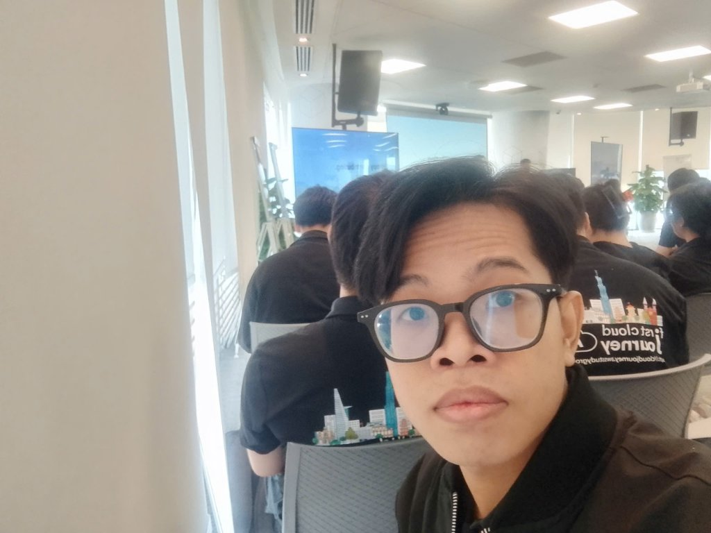
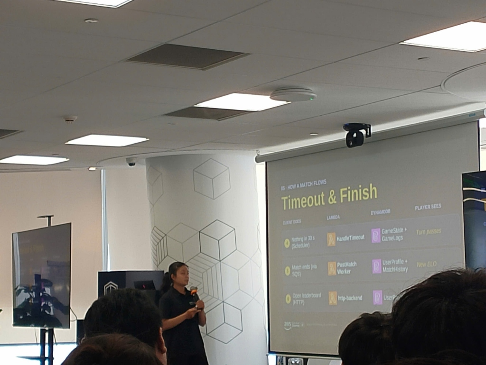
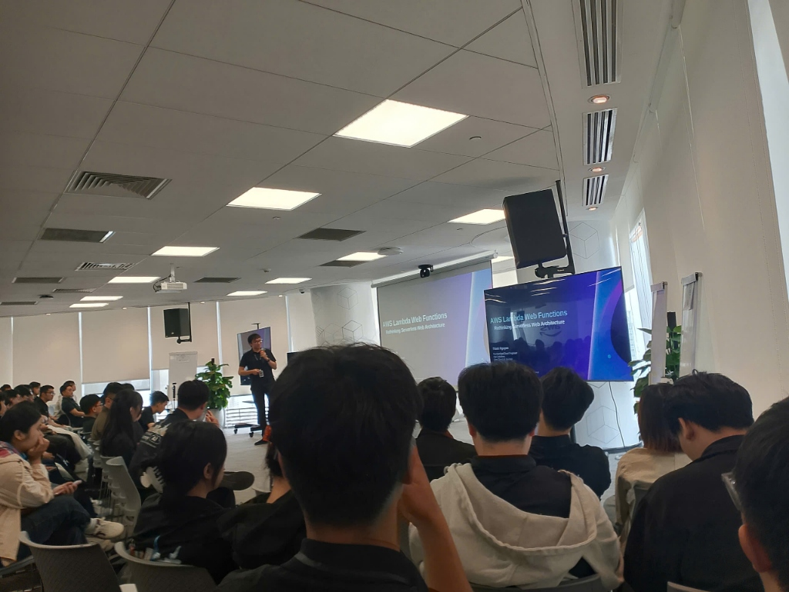

<h2 align="center">EVENT SUMMARY: FIRST CLOUD AI JOURNEY - COMMUNITY DAY</h2>

* **Organized Date & Time:** 09:00 - 12:00, October 31, 2026  
* **Location:** 26th Floor, Bitexco Financial Tower, 02 Hai Trieu, Ben Nghe Ward, District 1, Ho Chi Minh City  
* **Role:** Attendee

---

### Event Objectives

* Discover structured self-study methodologies, certification paths, and interactive learning through AWS Cloud Quest.
* Learn engineering mindsets for integrating AI into automated Pull Request reviews and End-to-End (E2E) testing pipelines.
* Gain real-world insights from a serverless Multiplayer Web Game project using Lambda, DynamoDB, SQS, and EventBridge, addressing challenges like Cold Starts.
* Explore Lambda Web Functions paired with CloudFront Origin Access Control (OAC) to eliminate API Gateway latency and optimize cloud spending.
* Understand resilient asynchronous architecture patterns using Amazon SQS, Long Polling, and Dead Letter Queues (DLQ).
* Acquire practical strategies and communication etiquette for contributing to large open-source projects.

---

### Speakers List

* Minh Tuấn - Cloud Enthusiast & Certified Builder
* Henry Đức Bùi - Head of Engineering at Cloud Tinker
* Phúc Khang - Former Intern at First Cloud Journey
* Thịnh Nguyễn - Dev Cloud Engineer at Styl Solution
* Cẩm Đào - Software & Cloud Engineer
* Hùng Trần - Senior Engineer at NAP

---

### Detailed Session Summaries

#### Session 1: Effective AWS Learning Pathways (06:46 - 22:45)
* Speaker: Minh Tuấn
* Summary:
  * Shared practical approaches to building a personalized AWS learning path from scratch toward professional certifications such as Solutions Architect and Developer.
  * Guided attendees on making the most of AWS Skill Builder resources, combining architectural blueprints with hands-on practice.
  * Introduced gamified learning through AWS Cloud Quest, where learners take on the role of a city engineer to resolve real infrastructure issues, reinforcing concepts much better than rote memorization.
  * Emphasized doing hands-on labs to build troubleshooting intuition, which is essential for tackling scenario-based exam questions.

#### Session 2: Accelerating Software Development with AI (22:50 - 46:30)
* Speaker: Henry Đức Bùi (Head of Engineering at Cloud Tinker)
* Summary:
  * Discussed reshaping engineering mindsets in the AI era, treating AI as a capable pair programmer rather than a human replacement.
  * Applied large language models to automate code reviews: integrating bots into GitHub/GitLab Pull Requests to spot syntax errors, flag security risks early, and suggest optimizations.
  * Built automated End-to-End (E2E) testing pipelines by generating realistic user-flow test cases with AI, catching regressions on CI/CD before deploying to staging.
  * Focused on team efficiency: freeing engineers from repetitive manual checks so they can concentrate on architectural design and core business logic.

#### Session 3: 3 Months Internship Journey at First Cloud Journey (46:36 - 1:19:30)
* Speaker: Phúc Khang
* Summary:
  * Reflected on the 3-month internship graduation project: building a real-time Multiplayer Web Game running entirely on a Serverless stack.
  * Architecture overview:
    * AWS Lambda and WebSocket APIs manage persistent bidirectional connections between players and game lobbies.
    * Amazon DynamoDB stores live game states, player profiles, and leaderboards with millisecond response times.
    * Amazon SQS and EventBridge queue player interactions and handle game notifications asynchronously.
  * Lessons learned:
    * Managing computing expenses during unexpected player surges.
    * Reducing Lambda cold start latency through Provisioned Concurrency and trimmed deployment bundles.
    * Adopting an event-driven mindset: keeping services decoupled and modular with built-in error handling.

#### Session 4: AWS Lambda Web Function (1:19:36 - 1:40:43)
* Speaker: Thịnh Nguyễn (Dev Cloud Engineer at Styl Solution)
* Summary:
  * Analyzed bottlenecks in traditional Lambda and API Gateway pairings: high request-based costs at scale, multi-hop network latency, and the 29-second timeout ceiling.
  * Introduced Lambda Web Adapter / Lambda Function URLs routed directly through Amazon CloudFront:
    * Run standard web frameworks (Express.js, FastAPI, Go Gin) on Lambda without rewriting code for API Gateway event formats.
    * Secure the Function URL using Origin Access Control (OAC), ensuring only authorized traffic through the CDN can invoke the function.
    * Add AWS WAF at the edge, eliminate API Gateway charges entirely, reduce network latency, and extend maximum execution time up to 15 minutes.

#### Session 5: Building Asynchronous Systems with Amazon SQS (1:40:57 - 1:59:15)
* Speaker: Cẩm Đào
* Summary:
  * Discussed shifting from synchronous request-response models to asynchronous event queues to ease database pressure and improve response times for users.
  * Utilized Amazon SQS as an elastic buffer to decouple frontend ingestion from heavy background processing.
  * Compared Short Polling with Long Polling, demonstrating how Long Polling reduces empty API calls, lowers querying costs, and speeds up message retrieval.
  * Configured Dead Letter Queues (DLQ) with a defined retry policy (maxReceiveCount) to isolate failed messages, allowing engineering teams to inspect errors without interrupting main workflows.

#### Session 6: Practical Guide to Open Source Contributions (1:59:17 - 2:27:00)
* Speaker: Hùng Trần (Senior Engineer at NAP)
* Summary:
  * Demystified open-source participation: newcomers do not need to be veteran experts or read entire massive codebases to start contributing.
  * Practical roadmap:
    * Start by looking for issues tagged `good first issue`, `documentation`, or `bug-reproduce` in popular repositories like Kubernetes, AWS SDKs, or Terraform.
    * Learn how to write clear issue descriptions, provide reproducible test cases, and submit structured Pull Requests.
    * Maintain polite and constructive communication, respecting maintainers' review capacity.
  * Cultivate patience: taking rigorous code review feedback as a valuable learning opportunity to sharpen coding standards and build a credible public portfolio.

---

### Event Experience

* Attending in person at the AWS Vietnam office (Bitexco Financial Tower) provided an engaging atmosphere with open discussions alongside seasoned engineers.
* The presentations struck a great balance between high-level guidance and concrete technical details, transparently analyzing trade-offs in operational costs and performance.
* Hearing real stories from the former intern's project and the open-source session provided strong encouragement to build personal projects and actively participate in technical communities.

---

### Key Outcomes

* Gained clear guidance on structuring self-study and certification goals using interactive AWS tools.
* Understood how to adopt Lambda Web Functions and CloudFront OAC to reduce costs and latency for serverless web applications.
* Mastered asynchronous system design with Amazon SQS, Long Polling, and error isolation via Dead Letter Queues.
* Learned how to apply AI tools effectively for automated code reviews and test generation on CI/CD pipelines.
* Felt more confident about taking the first steps toward contributing to global open-source projects.

---

### Lessons Learned

* Understanding service billing models and architecture boundaries enables much more cost-effective solutions than relying on default configurations.
* Designing with an async-first mindset is essential for maintaining stability and preventing bottlenecks in high-scale systems.
* The most effective learning always comes from getting hands-on: building real projects, troubleshooting unexpected errors, and sharing solutions with the community.

---

### Event Photos

<em>Attending First Cloud AI Journey: Community Day at the AWS Vietnam office (Bitexco Financial Tower)</em>

<em>Session 3: Phúc Khang explaining the Timeout & Finish flow of the Serverless Multiplayer Web Game (Lambda, DynamoDB, SQS)</em>

<em>Session 4: Thịnh Nguyễn presenting AWS Lambda Web Functions - Rethinking Serverless Web Architecture</em>

