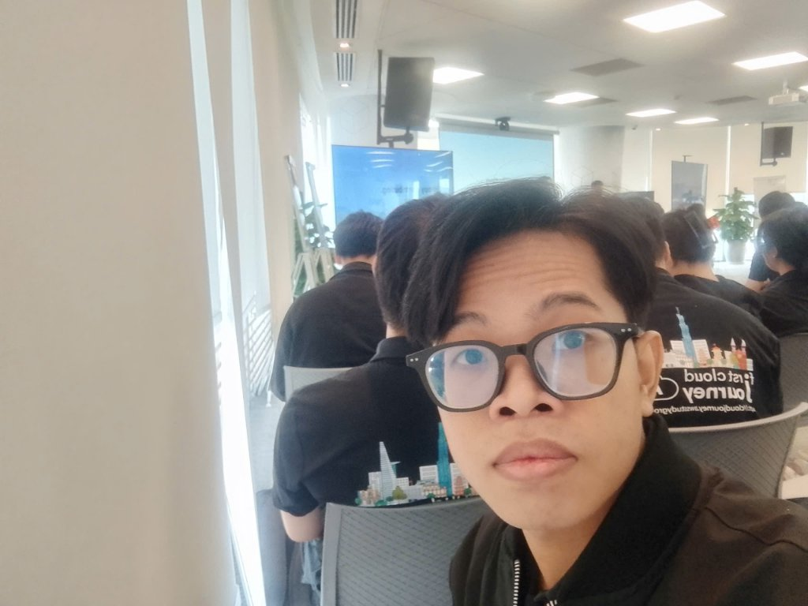
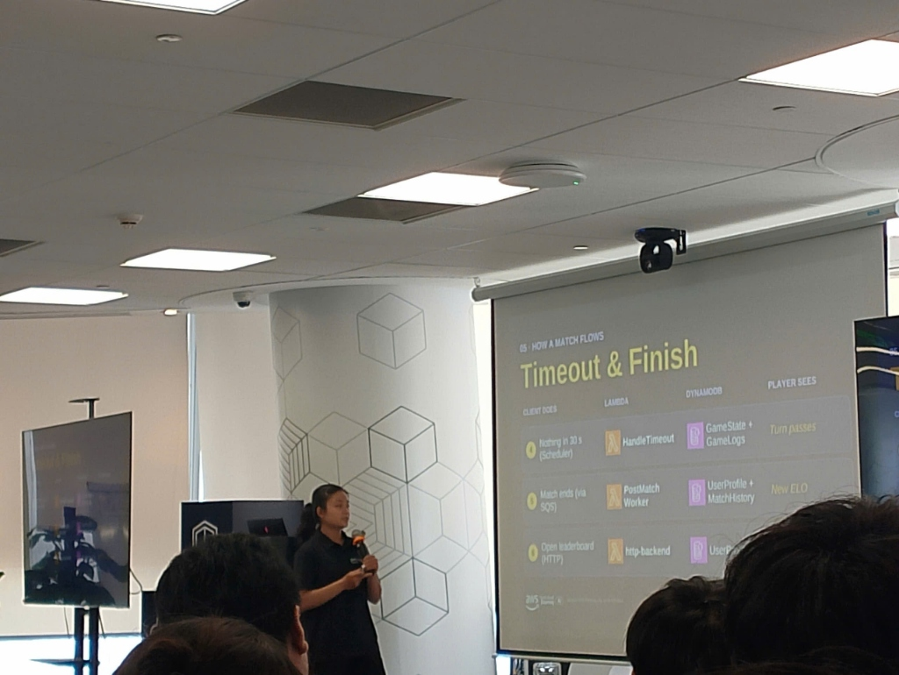
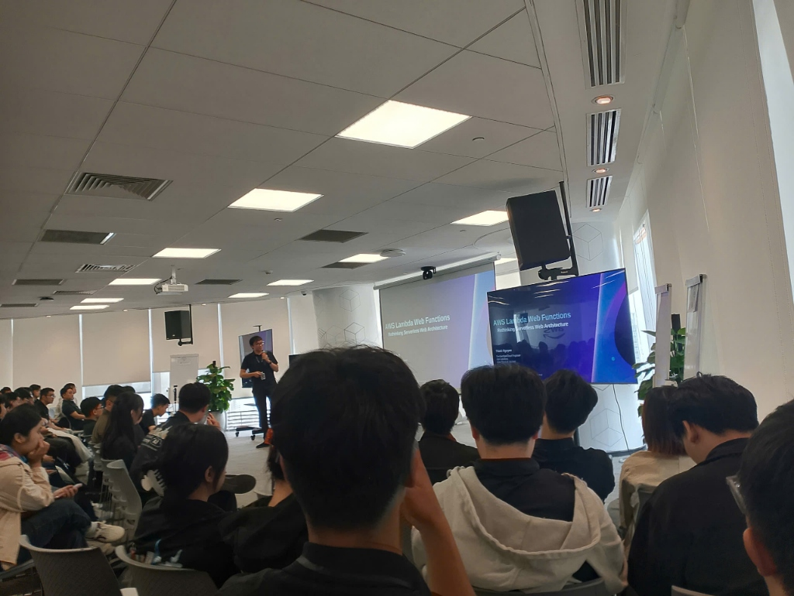

<h2 align="center">BÀI THU HOẠCH: FIRST CLOUD AI JOURNEY - COMMUNITY DAY</h2>

* **Thời gian tổ chức:** 09:00 - 12:00, ngày 31/10/2026
* **Địa điểm:** Tầng 26, Tòa nhà Bitexco Financial Tower, Số 02 Hải Triều, Phường Bến Nghé, Quận 1, TP.HCM
* **Vai trò:** Người tham dự

---

### Mục đích sự kiện

* Tiếp cận phương pháp tự học bài bản, lộ trình chinh phục chứng chỉ AWS và hình thức học qua trò chơi với Cloud Quest.
* Học hỏi tư duy ứng dụng AI để tự động hóa quy trình review mã nguồn (Pull Request) và kiểm thử hồi quy tự động (E2E testing).
* Tiếp thu kinh nghiệm thực tế về kiến trúc Serverless (Lambda, DynamoDB, SQS, EventBridge) và giải pháp xử lý vấn đề Cold Start qua dự án Web Game Multiplayer.
* Nắm bắt giải pháp kiến trúc Lambda Web Function kết hợp CloudFront OAC nhằm tối ưu chi phí và giảm độ trễ so với API Gateway truyền thống.
* Hiểu rõ nguyên lý thiết kế hệ thống xử lý bất đồng bộ chịu tải cao sử dụng Amazon SQS, kỹ thuật Long Polling và cơ chế Dead Letter Queue (DLQ).
* Định hình chiến lược và kỹ năng cần thiết để tham gia đóng góp hiệu quả vào các dự án mã nguồn mở lớn.

---

### Danh sách diễn giả

* Minh Tuấn - Cloud Enthusiast & Certified Builder
* Henry Đức Bùi - Head of Engineering tại Cloud Tinker
* Phúc Khang - Cựu thực tập sinh First Cloud Journey
* Thịnh Nguyễn - Dev Cloud Engineer tại Styl Solution
* Cẩm Đào - Software & Cloud Engineer
* Hùng Trần - Senior Engineer tại NAP

---

### Nội dung chi tiết các phiên chia sẻ

#### Session 1: Lộ trình học AWS hiệu quả (06:46 - 22:45)
* Diễn giả: Minh Tuấn
* Nội dung:
  * Chia sẻ phương pháp tự xây dựng lộ trình học tập AWS từ nền tảng đến các chứng chỉ chuyên nghiệp như Solutions Architect hay Developer.
  * Hướng dẫn tận dụng kho tài liệu từ AWS Skill Builder, kết hợp song song giữa lý thuyết kiến trúc và thực hành.
  * Giới thiệu hình thức học qua trò chơi (gamification) với AWS Cloud Quest, nơi người học đóng vai kỹ sư giải quyết sự cố hạ tầng trong thành phố ảo để nắm bắt tính năng dịch vụ một cách trực quan.
  * Khuyên người học nên tự làm các bài lab thực tế để rèn luyện kỹ năng xử lý sự cố (troubleshooting), chuẩn bị tốt nhất cho các câu hỏi tình huống trong bài thi.

#### Session 2: Tăng tốc phát triển phần mềm với AI (22:50 - 46:30)
* Diễn giả: Henry Đức Bùi (Head of Engineering tại Cloud Tinker)
* Nội dung:
  * Thảo luận về việc định hình lại tư duy kỹ thuật trong thời kỳ AI: xem AI như một trợ lý lập trình (pair programmer) đồng hành thay vì công cụ thay thế con người.
  * Ứng dụng mô hình ngôn ngữ lớn để tự động hóa khâu review mã nguồn: tích hợp bot AI vào quy trình Pull Request trên GitHub/GitLab nhằm quét lỗi cú pháp, phát hiện sớm nguy cơ bảo mật và gợi ý cách tối ưu code.
  * Xây dựng hệ thống kiểm thử End-to-End (E2E) tự động bằng cách dùng AI sinh kịch bản mô phỏng hành vi người dùng, phát hiện lỗi phát sinh trên luồng CI/CD trước khi đưa lên môi trường thử nghiệm.
  * Cách tổ chức công việc để kỹ sư thoát khỏi các thao tác kiểm tra thủ công lặp lại, dành thời gian tập trung vào thiết kế kiến trúc và giải quyết bài toán nghiệp vụ.

#### Session 3: Trải nghiệm 3 tháng thực tập tại First Cloud Journey (46:36 - 1:19:30)
* Diễn giả: Phúc Khang
* Nội dung:
  * Tổng kết trải nghiệm qua dự án tốt nghiệp 3 tháng thực tập: xây dựng hệ thống Web Game Multiplayer chạy trên nền tảng Serverless hoàn toàn.
  * Phân tích kiến trúc hệ thống:
    * AWS Lambda kết hợp WebSocket API để duy trì kết nối hai chiều thời gian thực giữa các người chơi.
    * Amazon DynamoDB chịu trách nhiệm lưu trạng thái phòng chơi (game state), thông tin tài khoản và bảng xếp hạng với tốc độ mili-giây.
    * Amazon SQS và EventBridge xếp hàng các sự kiện tương tác và điều phối luồng thông báo trong game một cách bất đồng bộ.
  * Các bài học đúc kết được:
    * Cách kiểm soát chi phí điện toán khi số lượng người chơi biến động bất ngờ.
    * Biện pháp hạn chế độ trễ khởi động lạnh (cold start) của Lambda, bao gồm dùng Provisioned Concurrency và tinh gọn kích thước gói triển khai.
    * Tư duy tiếp cận Serverless: thiết kế hướng sự kiện (event-driven), chia nhỏ chức năng thành từng module độc lập và chuẩn bị sẵn phương án xử lý khi có dịch vụ gặp lỗi.

#### Session 4: AWS Lambda Web Function (1:19:36 - 1:40:43)
* Diễn giả: Thịnh Nguyễn (Dev Cloud Engineer tại Styl Solution)
* Nội dung:
  * Đánh giá những điểm nghẽn của mô hình Lambda kết hợp API Gateway truyền thống: chi phí tích lũy theo số lượng request lớn khi đạt hàng triệu lượt gọi, phát sinh thêm độ trễ qua các chặng trung chuyển, và giới hạn timeout 29 giây.
  * Giới thiệu giải pháp Lambda Web Adapter / Lambda Function URLs kết hợp trực tiếp với Amazon CloudFront:
    * Giúp chạy trực tiếp các web framework quen thuộc (như Express.js, FastAPI, Go Gin) trên Lambda mà không cần chỉnh sửa mã nguồn cho khớp với sự kiện của API Gateway.
    * Sử dụng cơ chế Origin Access Control (OAC) từ CloudFront để bảo vệ Function URL, chỉ cho phép các yêu cầu hợp lệ đi qua CDN mới được kích hoạt hàm Lambda.
    * Kết hợp thêm lớp bảo vệ AWS WAF tại biên, cắt giảm toàn bộ chi phí API Gateway, hạ thấp độ trễ mạng và mở rộng thời gian xử lý tối đa lên đến 15 phút.

#### Session 5: Xây dựng hệ thống bất đồng bộ trên Amazon SQS (1:40:57 - 1:59:15)
* Diễn giả: Cẩm Đào
* Nội dung:
  * Phân tích lợi ích khi chuyển đổi từ giao tiếp đồng bộ (chờ phản hồi ngay) sang kiến trúc bất đồng bộ (qua hàng đợi sự kiện) nhằm giảm áp lực cho máy chủ và cải thiện thời gian phản hồi cho người dùng.
  * Ứng dụng Amazon SQS làm lớp đệm trung gian để tách rời dịch vụ tiếp nhận yêu cầu khỏi dịch vụ xử lý dữ liệu nặng phía sau.
  * So sánh giữa Short Polling và Long Polling, chỉ ra cách Long Polling giúp giảm tối đa các lần gọi API trống, tiết kiệm chi phí truy vấn và tiếp nhận tin nhắn mới nhanh chóng.
  * Thiết lập hàng đợi tin nhắn chết (Dead Letter Queue - DLQ) kèm số lần thử lại tối đa (maxReceiveCount) để cách ly các tin nhắn lỗi, giúp đội ngũ kỹ thuật dễ dàng tra cứu nguyên nhân mà không ảnh hưởng đến luồng vận hành chung.

#### Session 6: Đóng góp mã nguồn mở (Open Source) (1:59:17 - 2:27:00)
* Diễn giả: Hùng Trần (Senior Engineer tại NAP)
* Nội dung:
  * Chia sẻ góc nhìn thực tế về mã nguồn mở: người mới bắt đầu không nhất thiết phải là chuyên gia hay phải đọc hiểu toàn bộ dự án đồ sộ.
  * Lộ trình tham gia đóng góp:
    * Tìm kiếm các vấn đề có nhãn `good first issue`, chỉnh sửa tài liệu (`documentation`) hoặc hỗ trợ tái hiện lỗi (`bug-reproduce`) trên các kho mã nguồn mở quen thuộc như Kubernetes, AWS SDKs, Terraform.
    * Kỹ năng mô tả lỗi rõ ràng, đính kèm bằng chứng kiểm thử và viết Pull Request mạch lạc.
    * Giữ thái độ giao tiếp hòa nhã, tôn trọng các maintainer của dự án.
  * Duy trì tính kiên trì khi nhận phản hồi review mã, xem các góp ý là bài học quý giá để nâng cao tiêu chuẩn lập trình và từng bước xây dựng uy tín cá nhân trong cộng đồng.

---

### Trải nghiệm tại sự kiện

* Không gian học hỏi trực tiếp tại văn phòng AWS Bitexco mang lại cơ hội tiếp xúc, thảo luận rất cởi mở với các diễn giả và kỹ sư giàu kinh nghiệm.
* Nội dung các bài chia sẻ vừa mang tính định hướng, vừa đi sâu vào kỹ thuật thực tế, thẳng thắn phân tích các bài toán đánh đổi về chi phí và hiệu năng vận hành.
* Các câu chuyện thực tế về đề tài tốt nghiệp của cựu thực tập sinh và kinh nghiệm đóng góp Open Source đã tạo thêm nhiều động lực để chủ động tự xây dựng dự án và rèn luyện kỹ năng thực tế.

---

### Kết quả đạt được

* Có định hướng rõ ràng về cách lập kế hoạch tự học, chuẩn bị chứng chỉ kết hợp các công cụ học tập tương tác của AWS.
* Hiểu cách áp dụng giải pháp Lambda Web Function và CloudFront OAC để giảm chi phí cũng như độ trễ cho ứng dụng web không máy chủ.
* Nắm chắc cách tổ chức hệ thống bất đồng bộ với Amazon SQS, Long Polling và xử lý ngoại lệ qua Dead Letter Queue.
* Học được cách ứng dụng AI hỗ trợ rà soát mã nguồn và tạo bài kiểm thử tự động trên luồng CI/CD.
* Tự tin hơn về cách bắt đầu tham gia đóng góp cho các dự án mã nguồn mở quốc tế.

---

### Bài học rút ra

* Hiểu rõ cơ chế tính giá và kiến trúc từng dịch vụ giúp lựa chọn giải pháp tối ưu chi phí hơn rất nhiều so với việc chỉ áp dụng cấu hình mặc định.
* Thiết kế hướng bất đồng bộ là yếu tố then chốt giúp các ứng dụng quy mô lớn duy trì được sự ổn định và tránh nghẽn cổ chai khi lưu lượng tăng đột biến.
* Kỹ năng học tập hiệu quả nhất luôn đi đôi với việc tự bắt tay vào thực hành, làm dự án, chủ động giải quyết lỗi phát sinh và đóng góp lại cho cộng đồng.

---

### Một số hình ảnh khi tham gia sự kiện

<em>Tham dự sự kiện First Cloud AI Journey: Community Day tại văn phòng AWS (Bitexco Financial Tower)</em>

<em>Session 3: Phúc Khang trình bày luồng vận hành Timeout & Finish của Web Game Multiplayer Serverless (Lambda, DynamoDB, SQS)</em>

<em>Session 4: Thịnh Nguyễn chia sẻ giải pháp AWS Lambda Web Functions - Rethinking Serverless Web Architecture</em>

