# BÁO CÁO DỰ TOÁN CHI PHÍ HỆ THỐNG — AI CV SCREENING PORTAL
## Căn cứ Kiến trúc Chính thức v12.0 (Pure Serverless / Zero-VPC / Zero-Cost Network)

> **Mã tài liệu:** `DOC-COST-01` · **Phiên bản:** `2.0 (Chuẩn hóa theo 2 bản xuất AWS Calculator chính thức)`  
> **Ngày lập:** 30/10/2026 · **Khu vực áp dụng (Region):** `us-east-1` / `us-east-2`  
> **Công cụ tính toán:** [AWS Pricing Calculator](https://calculator.aws/) & Bảng đơn giá chính thức AWS 2026  
> **Tài liệu đối chiếu:** [pricing-calculator-guide.md](pricing-calculator-guide.md) · [system-architecture.md](../architecture/system-architecture.md) · [tech-stack.md](../architecture/tech-stack.md)

---

## 1. Tóm tắt Điều hành (Executive Summary)

Hệ thống **AI CV Screening Portal** vận hành theo triết lý **Pure Serverless (Zero-VPC / Zero-Cost Network)**, kết hợp bảo mật IAM Least Privilege, mã hóa KMS CMK và sức mạnh suy luận của mô hình **Anthropic Claude Haiku 4.5** trên **Amazon Bedrock**.

Dự toán chi phí đã được lập và trích xuất thành công **2 phiên bản chi phí cụ thể** trên công cụ AWS Pricing Calculator:

### 🌟 Hai Phiên Bản Chi Phí Dự Toán Chính Thức:

| Tiêu chí | Phiên bản 1: Pricing Demo (Workshop / Lab) | Phiên bản 2: Production SMB Pricing (Doanh nghiệp vừa) |
| :--- | :---: | :---: |
| **Quy mô xử lý** | **100 CVs / tháng** (2.500 API calls) | **2.000 CVs / tháng** (50.000 API calls) |
| **Số tin tuyển dụng (JDs)** | 5 JDs | 50 JDs |
| **Bảo vệ biên AWS WAF** | Chế độ cơ bản ($0.00) | Kích hoạt WAF 6 lớp ($0.03 request fee) |
| **Chi phí ban đầu (Upfront)** | **$0.00 USD** | **$0.00 USD** |
| **Chi phí hàng tháng (Monthly)** | **$18.63 USD / tháng** *(~465.000 VNĐ)* | **$28.08 USD / tháng** *(~700.000 VNĐ)* |
| **Chi phí cả năm (12 Months)** | **$223.56 USD / năm** | **$336.96 USD / năm** |
| **Đơn giá trên 1 CV (Unit Cost)** | ~$0.186 USD / CV (do tải demo nhỏ) | **~$0.014 USD / CV (~350 VNĐ / hồ sơ)** |
| **Public Share URL** | [Xem bảng tính Demo](https://calculator.aws/#/estimate?id=fbd390a41c4d6d5786fef2452b89899ff8cde02e) | [Xem bảng tính Production SMB](https://calculator.aws/#/estimate?id=b88f16b1a3adbc422df267b8ddd3724e74ed9dfe) |
| **Tệp dữ liệu gốc đã lưu** | [`Pricing Demo.json`](Pricing%20Demo.json) · [`Pricing Demo.pdf`](Pricing%20Demo.pdf) | [`Production SMB Pricing.json`](Production%20SMB%20Pricing.json) · [`Production SMB Pricing.pdf`](Production%20SMB%20Pricing.pdf) |

### Các kết luận tài chính cốt lõi:
1. **Chi phí cố định mạng = $0.00/tháng:** Nhờ loại bỏ hoàn toàn VPC, NAT Gateway ($32.85/tháng) và 8 Interface Endpoints / PrivateLink ($58.40 – $115.20/tháng) theo quyết định `ADR-06`, hệ thống không phát sinh bất kỳ khoản phí nhàn rỗi nào khi không có ứng viên nộp hồ sơ.
2. **Hiệu quả kinh tế vượt trội:** Với chi phí **$28.08 USD / tháng** để sàng lọc tự động 2.000 hồ sơ ứng viên (kèm bóc tách OCR, khử định danh PII, AI rubric 100đ và push WebSocket real-time), chi phí trung bình chỉ **~350 VNĐ / hồ sơ**, giúp doanh nghiệp **tiết kiệm hơn 98%** chi phí sàng lọc CV so với quy trình thủ công truyền thống.
3. **Tiết kiệm 95% – 98% so với kiến trúc VPC Enterprise:** Kiến trúc VPC có NAT Gateway tiêu tốn từ $1.800 đến $2.500 USD/năm, trong khi toàn bộ hệ thống Pure Serverless này chỉ tốn **~$336.96 USD / năm**.

---

## 2. Kịch bản Tính toán & Giả định Định lượng (Workload Assumptions)

Hệ sinh thái tuyển dụng được lập dự toán đối chiếu trên các kịch bản định lượng:

| Tham số giả định | Phiên bản 1: Demo / Workshop | Phiên bản 2: Production SMB | Kịch bản 3: Doanh nghiệp lớn |
| :--- | :---: | :---: | :---: |
| **Số tin tuyển dụng đồng thời (JDs)** | 5 JDs | 50 JDs | 500 JDs |
| **Số hồ sơ nộp (CV PDF / tháng)** | **100 CVs** | **2.000 CVs** | **20.000 CVs** |
| **Dung lượng & định dạng CV** | PDF $\le$ 5MB (trung bình 2 trang) | PDF $\le$ 5MB (trung bình 2 trang) | PDF $\le$ 5MB (trung bình 2.5 trang) |
| **Số trang Textract OCR** | 200 trang | 4.000 trang | 50.000 trang |
| **Số token Bedrock Input / CV** | 2.500 tokens | 2.500 tokens | 2.500 tokens |
| **Số token Bedrock Output / CV** | 800 tokens | 800 tokens | 800 tokens |
| **Tần suất gọi AI Bedrock** | 1 req/phút, 1 giờ/ngày | 1 req/phút, 1 giờ/ngày (~1.800 reqs) | 5 req/phút, 4 giờ/ngày |
| **Số request REST API / tháng** | 2.500 requests | 50.000 requests | 500.000 requests |
| **WebSocket sessions & messages** | 5 sessions/ngày, 500 msgs | 55 sessions/ngày, 10.000 msgs | 500 sessions/ngày, 100.000 msgs |
| **Dung lượng quét GuardDuty S3** | 1 GB / tháng | 4 GB / tháng | 40 GB / tháng |
| **Dung lượng S3 lưu trữ lũy kế** | 0.5 GB (Lifecycle 90 ngày) | 5.0 GB (Lifecycle 90 ngày) | 50.0 GB (Lifecycle 90 ngày) |
| **Số lượng Email SES gửi đi** | 150 emails | 3.000 emails | 30.000 emails |
| **Số lượng CloudWatch Alarms** | 3 Alarms | 3 Alarms | 10 Alarms |
| **Amplify CI/CD & Băng thông** | 50 build mins, 1GB store, 5GB served | 50 build mins, 5GB store, 15GB served | 100 build mins, 10GB store, 100GB served |

---

## 3. Bảng Bóc Tách Chi Phí Chi Tiết Đối Chiếu 2 Phiên Bản Thực Tế

Bảng dưới đây trích xuất **100% dữ liệu chi phí thực tế** từ hai tệp kết quả dự toán đã xuất:
* **Demo:** [`Pricing Demo.json`](Pricing%20Demo.json) (Tổng: **$18.63 USD / tháng**)
* **Production SMB:** [`Production SMB Pricing.json`](Production%20SMB%20Pricing.json) (Tổng: **$28.08 USD / tháng**)

| STT | Dịch vụ trong bảng tính AWS | Phiên bản 1: Demo / Workshop | Phiên bản 2: Production SMB | Chênh lệch (SMB - Demo) | Giải thích nguyên nhân biến động |
| :---: | :--- | :---: | :---: | :---: | :--- |
| 1 | **Anthropic (Bedrock Claude Haiku 4.5)** | **$11.70** | **$11.70** | $0.00 | Cả 2 cùng cấu hình công suất xử lý 1 req/phút, 1h/ngày, 2.500 in / 800 out tokens. |
| 2 | **Amazon Textract** | **$0.30** | **$6.00** | +$5.70 | Demo phân tích 200 trang ($0.30) vs SMB phân tích 4.000 trang ($6.00). |
| 3 | **AWS Amplify Hosting** | **$1.27** | **$2.87** | +$1.60 | SMB tăng dung lượng lưu trữ (5GB) và băng thông tải trang (15GB). |
| 4 | **Amazon CloudWatch** | **$1.31** | **$2.82** | +$1.51 | SMB thu thập 5 GB logs JSON (thay vì 2 GB của Demo) + 3 Standard Alarms. |
| 5 | **DynamoDB on-demand capacity** | **$0.51** | **$1.25** | +$0.74 | SMB tăng dung lượng dữ liệu lên 5 GB và khối lượng truy vấn On-Demand. |
| 6 | **AWS Key Management Service (KMS)** | **$1.06** | **$1.15** | +$0.09 | Cả 2 dùng 1 CMK ($1.00 cố định), SMB phát sinh thêm $0.09 phí 50k requests. |
| 7 | **Amazon GuardDuty** | **$0.11** | **$0.79** | +$0.68 | Demo quét 1 GB CV ($0.11) vs SMB quét 4 GB CV mã độc ($0.79). |
| 8 | **AWS Secrets Manager** | **$0.40** | **$0.40** | $0.00 | Duy trì 1 secret tĩnh bảo mật cho thông tin tích hợp. |
| 9 | **Amazon SES (Email)** | **$0.01** | **$0.30** | +$0.29 | Demo gửi 150 email vs SMB gửi 3.000 email thông báo kết quả và OTP. |
| 10 | **S3 Standard** | **$0.04** | **$0.23** | +$0.19 | Demo lưu 0.5 GB / 4k PUT vs SMB lưu 5 GB / 20k PUT requests. |
| 11 | **Step Functions - Standard** | **$0.00** | **$0.30** | +$0.30 | Demo (800 st) nằm trong Free Tier 4k st; SMB (16k st) tính phí vượt 12k st. |
| 12 | **Amazon API Gateway** | **$0.01** | **$0.19** | +$0.18 | SMB xử lý 50.000 REST requests và 10.000 WebSocket messages. |
| 13 | **AWS WAF** | **$0.00** | **$0.03** | +$0.03 | Phí phân tích web request biên của WAF cho 50.000 requests. |
| 14 | **Amazon SQS** | **$0.00** | **$0.02** | +$0.02 | 0.05 million requests xử lý hàng đợi điều phối. |
| 15 | **Amazon EventBridge** | **$0.00** | **$0.02** | +$0.02 | EventBridge Pipes kéo tin từ SQS kích hoạt Step Functions. |
| 16 | **Amazon Cognito** | **$0.00** | **$0.01** | +$0.01 | Demo 100 MAU ($0.00) vs SMB 1.500 MAU ($0.01). |
| 17 | **AWS Lambda** | **$0.00** | **$0.00** | $0.00 | Nằm trọn trong hạn mức miễn phí 1.000.000 requests của AWS Free Tier. |
| 18 | **Amazon CloudFront** | **$0.00** | **$0.00** | $0.00 | Miễn phí 1 TB data transfer out qua Free Plan. |
| 19 | **Data Transfer** | **$0.00** | **$0.00** | $0.00 | Truyền tải nội bộ giữa các dịch vụ Serverless trên AWS Backbone. |
| 20 | **AWS CloudTrail** | **$0.00** | **$0.00** | $0.00 | Luồng Management Event Trail đầu tiên miễn phí. |
| 21 | **AWS IAM Access Analyzer** | **$0.00** | **$0.00** | $0.00 | Kiểm toán phân quyền IAM miễn phí. |
| 22 | **Amazon Augmented AI (A2I)** | **$0.00** | **$0.00** | $0.00 | Duyệt Human-in-the-loop qua HR nội bộ (Private Workforce) miễn phí. |
| **TỔNG CỘNG** | **22 DỊCH VỤ / THÀNH PHẦN** | **$18.63 USD / tháng** | **$28.08 USD / tháng** | **+$9.45 USD** | **Tăng từ 100 CV lên 2.000 CV chi phí chỉ tăng thêm ~240.000 VNĐ!** |

---

## 4. Phân Tích Đơn Giá Trên Từng Hồ Sơ (Unit Cost Economics)

Một trong những chỉ số FinOps quan trọng nhất của hệ sinh thái tuyển dụng là **Chi phí công nghệ để sàng lọc hoàn chỉnh 1 CV (Cost per Screened CV)** trong môi trường vận hành thực tế (Production SMB):

$$\text{Tổng chi phí vận hành SMB} = \$28.08\text{ USD / tháng}$$
$$\text{Số lượng hồ sơ xử lý} = 2.000\text{ CVs / tháng}$$

$$\text{Đơn vị chi phí trên 1 CV (All-in Unit Cost)} = \frac{\$28.08}{2.000\text{ CV}} = \mathbf{\$0.01404\text{ USD / CV}}$$

> [!NOTE]
> * Quy đổi ra tiền Việt Nam Đồng (tỷ giá $1\text{ USD} \approx 25.400\text{ VNĐ}$): **Chỉ ~350 VNĐ / hồ sơ ứng viên**.
> * **Bóc tách chi phí cấu thành 350 VNĐ:**
>   * **Amazon Bedrock (Claude Haiku 4.5):** ~145 VNĐ (42%)
>   * **Amazon Textract (OCR 2 trang PDF):** ~75 VNĐ (21%)
>   * **Giám sát & Hosting (CloudWatch + Amplify):** ~70 VNĐ (20%)
>   * **Lưu trữ & Mã hóa (DynamoDB + S3 + KMS):** ~35 VNĐ (10%)
>   * **Mạng, API & Quét mã độc (GuardDuty + APIGW + SES + WAF):** ~25 VNĐ (7%)
> * **So sánh với chi phí nhân sự:** Một chuyên viên tuyển dụng duyệt thủ công 1 CV mất trung bình 5–10 phút (tương đương 15.000 – 30.000 VNĐ tiền lương công nhật). Hệ thống giúp **tiết kiệm hơn 98% chi phí sàng lọc bước đầu**.

---

## 5. Đối Chiếu Giá Trị Kinh Tế: Pure Serverless vs Kiến Trúc Truyền Thống

Biểu đồ so sánh chi phí hàng tháng giữa 2 mô hình kiến trúc:

```mermaid
xychart-beta
    title "So sánh Chi phí Hàng tháng: VPC Truyền thống vs Pure Serverless v12.0 (USD)"
    x-axis ["0 CV (Idle)", "100 CVs (Demo)", "2.000 CVs (SMB)", "20.000 CVs (Enterprise)"]
    y-axis "Chi phí hàng tháng (USD)" 0 --> 400
    bar [147.60, 166.23, 175.68, 388.18]
    bar [0.00, 18.63, 28.08, 240.58]
```

*(Cột 1: Kiến trúc VPC Enterprise với NAT & PrivateLink; Cột 2: Kiến trúc Pure Serverless v12.0 theo kết quả Calculator thực tế)*

| Thành phần chi phí | Kiến trúc VPC Enterprise Truyền thống | Kiến trúc Pure Serverless v12.0 (Thực tế) | Mức tiết kiệm hàng tháng |
| :--- | :---: | :---: | :---: |
| **NAT Gateway (1 AZ)** | $0.045/giờ x 730 giờ = **$32.85/tháng** | **$0.00** *(Không dùng)* | Tiết kiệm $32.85 (100%) |
| **8 Interface Endpoints (PrivateLink)** | 8 x $0.01/giờ x 730 giờ = **$58.40/tháng** (1 AZ) *(hoặc $115.20 nếu 2 AZ)* | **$0.00** *(Không dùng)* | Tiết kiệm $58.40 – $115.20 (100%) |
| **Xử lý dữ liệu qua Endpoint (Data Fee)** | ~$0.01/GB trung chuyển | **$0.00** *(AWS Backbone miễn phí)* | Tiết kiệm 100% |
| **Chi phí cố định mạng khi không có CV (Idle)** | **$91.25 – $148.05 / tháng** | **$0.00 / tháng** | **Tiết kiệm 100% chi phí nhàn rỗi** |
| **Tổng chi phí năm (Tải 2.000 CV/tháng)** | **~$2.108 USD / năm** | **~$336.96 USD / năm** | **Tiết kiệm ~$1.771 USD / năm (~45 triệu VNĐ)** |

---

## 6. Chiến Lược FinOps & Kiểm Soát Ngân Sách An Toàn

Để đảm bảo hệ thống không bao giờ vượt quá ngân sách thử nghiệm và vận hành, các biện pháp kỹ thuật sau được cấu hình trực tiếp trong mã nguồn CDK:

1. **AWS Budgets Alert:**
   * Tạo Budget tự động qua CloudFormation/CDK với hạn mức **$10.00 USD / tháng** (cho môi trường Demo) và **$35.00 USD / tháng** (cho môi trường Production SMB).
   * Cảnh báo qua email tại 2 mốc: **50%** và **80%**.
2. **Cờ Bật/Tắt WAF (`enableWaf` parameter):**
   * Trong file cấu hình hạ tầng `config/environment.ts`, thuộc tính `enableWaf` được đặt mặc định là `false` cho môi trường `dev` và `demo`.
   * Chỉ bật `enableWaf: true` khi triển khai môi trường `production`.
3. **Vòng đời Dữ liệu Tự động (S3 Lifecycle Rules):**
   * Tự động xóa tệp CV trong bucket `quarantine/` sau **24 giờ** nếu không hợp lệ hoặc quét mã độc phát hiện nguy cơ.
   * Tự động xóa hồ sơ CV đã xử lý sau **90 ngày**, triệt tiêu chi phí tích lũy dung lượng S3 theo thời gian.
4. **Time-To-Live (TTL) trên DynamoDB:**
   * Kích hoạt thuộc tính `expire_at` cho các bản ghi phiên tạm, log WebSocket connection và kết quả nháp, DynamoDB tự động thu dọn dữ liệu miễn phí mà không tiêu tốn Write Request Units (WRU).
5. **Giới hạn Payload & Token Bedrock:**
   * Ép chặt dung lượng file upload $\le$ 5MB.
   * Khử PII và cắt gọt văn bản CV trích xuất tối đa **50.000 ký tự** trước khi đưa vào Bedrock, ngăn ngừa rủi ro vượt ngưỡng token hoặc các cuộc tấn công gây lãng phí chi phí (Cost Denial of Service).
